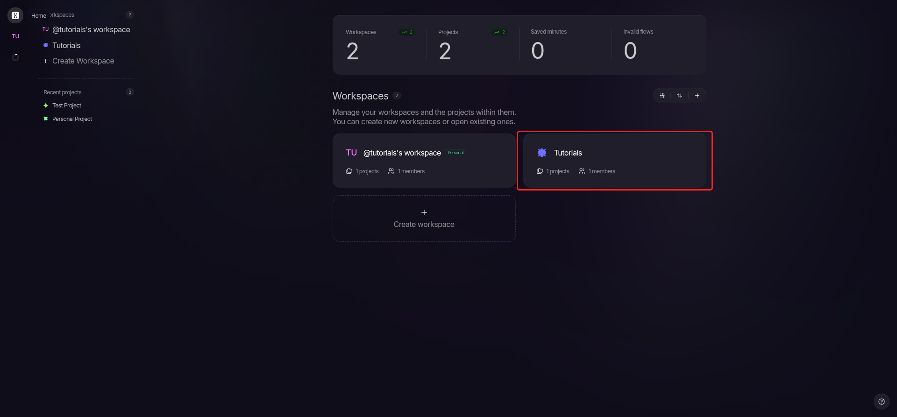
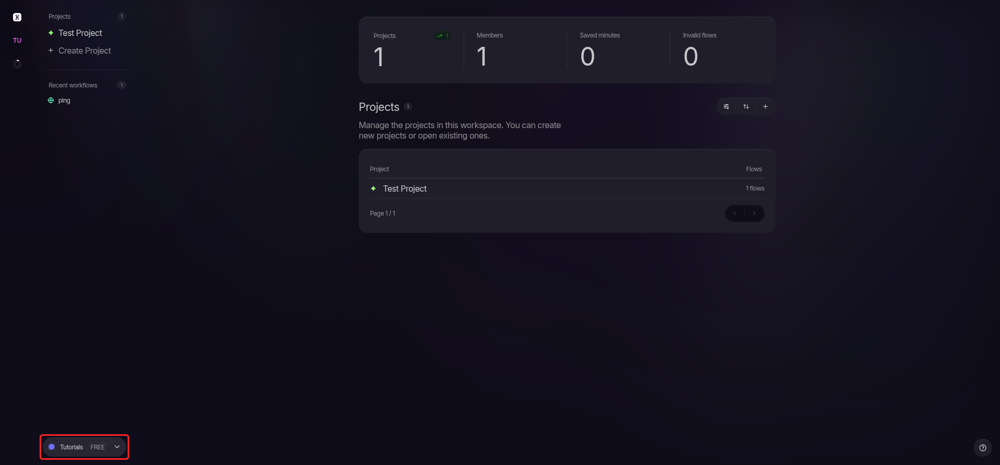
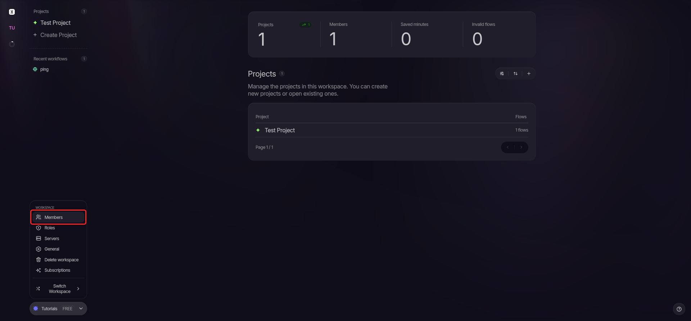
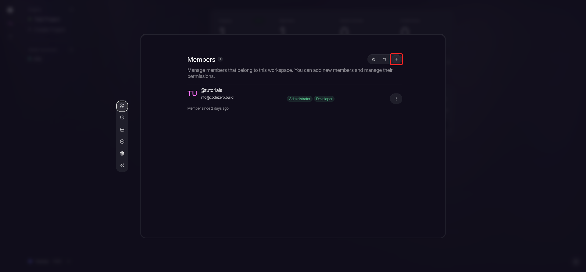
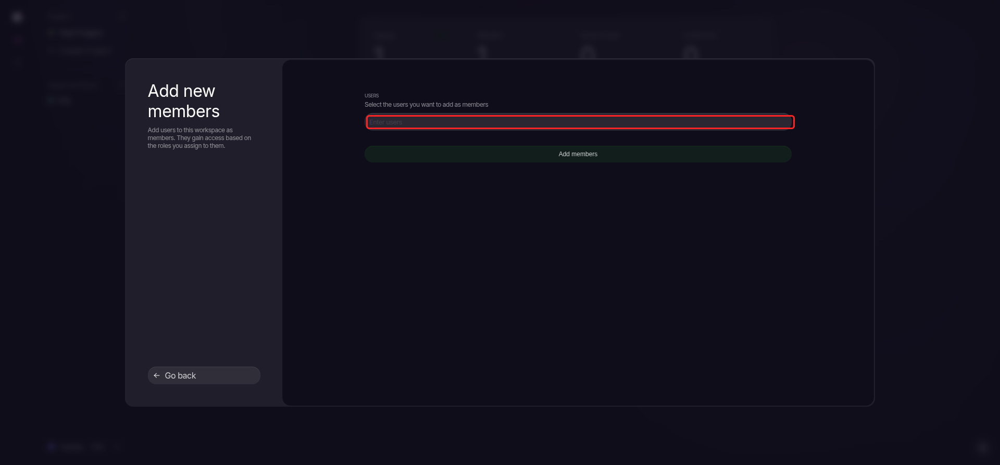
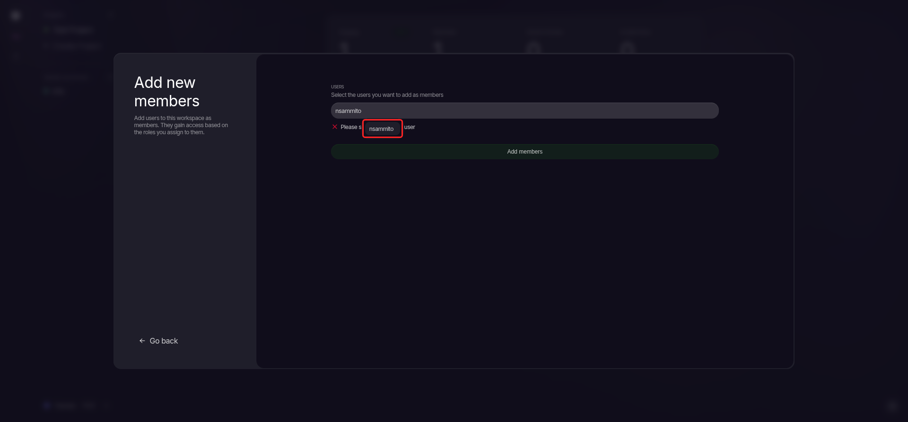
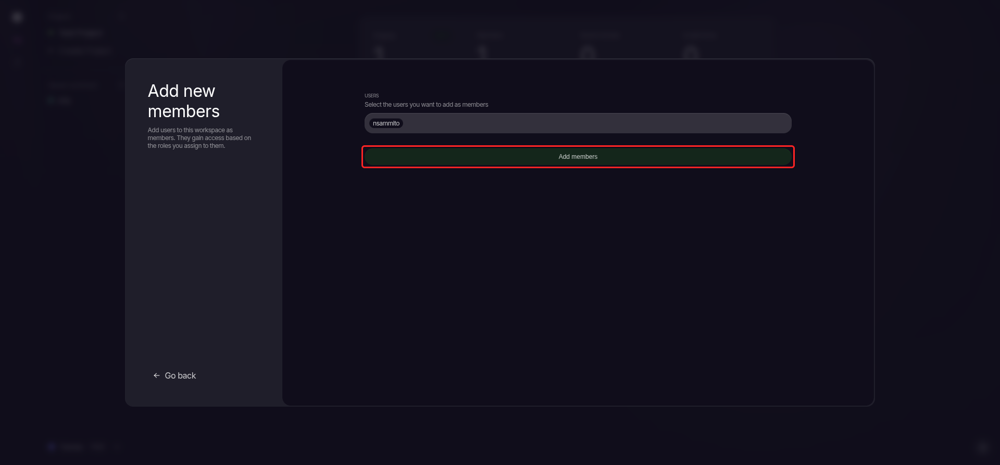
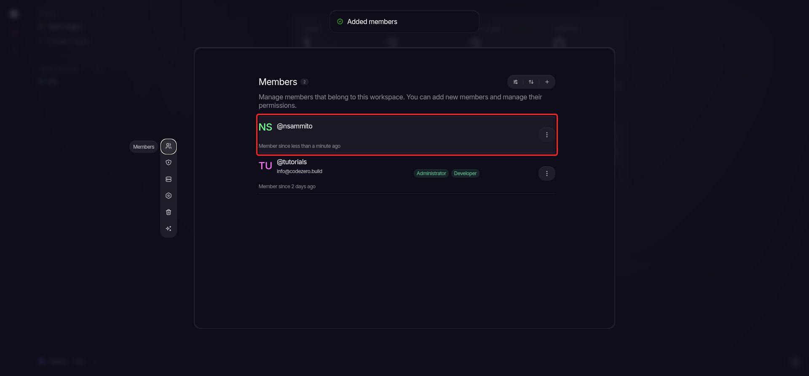

import { Callout } from 'fumadocs-ui/components/callout';
import { Step, Steps } from 'fumadocs-ui/components/steps';

Members are the users who work together in a workspace.
In this guide we'll add an existing user to a workspace as a new member.

<Callout type="info">
  **Prerequisite:** You are allowed to manage the members of the workspace, and the user you want to add already has an account.
</Callout>

---

<Steps>
<Step>

## Open the workspace

On the home dashboard, click on the workspace you want to add the member to.

</Step>
<Step>

## Open the workspace menu

At the bottom left of the sidebar, click on the workspace name to open the workspace menu.

</Step>
<Step>

## Open the members

Click **Members** in the workspace menu.

</Step>
<Step>

## Click the add button

Click the **+** button at the top right of the **Members** list.

</Step>
<Step>

## Enter the username

The **Add new members** page opens. Click into the **Users** field and start typing the username of the user you want to add.

</Step>
<Step>

## Select the user

Matching users appear below the field. Click on the right one to select it.
You can select several users to add them all at once.

</Step>
<Step>

## Add the members

Click **Add members**.

</Step>
<Step>

## Check the result

An **Added members** message confirms the change, and the new member appears in the **Members** list of the workspace, still without any roles.

</Step>
</Steps>

---

### What are my next steps?

New members start without any roles. Follow the [Assigning a role](./quick_assigning_a_role.mdx) tutorial to give them permissions.
