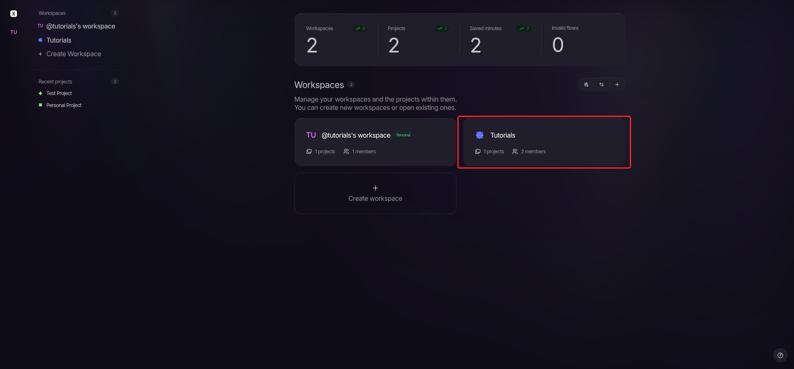
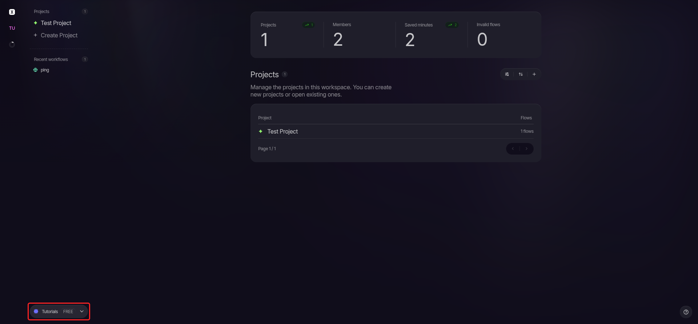
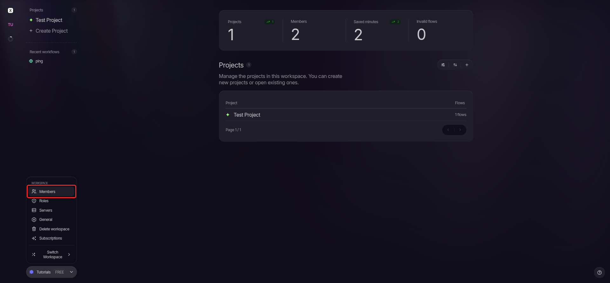
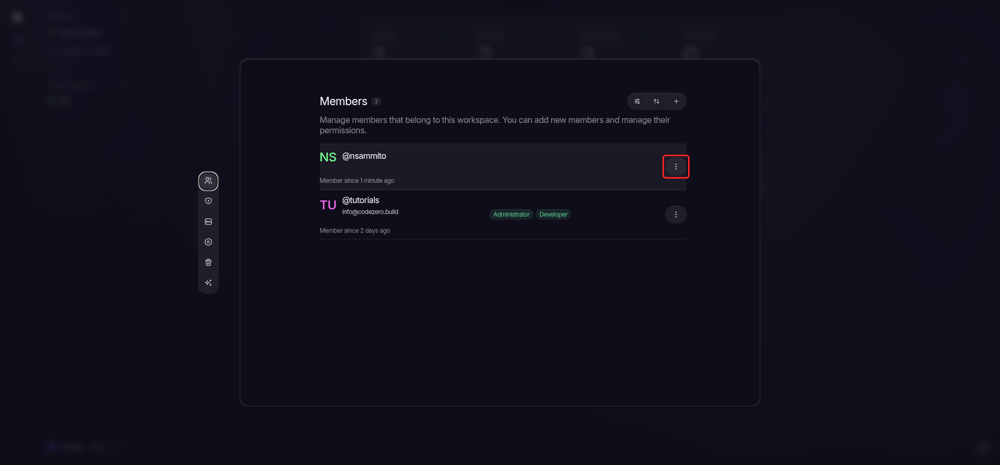
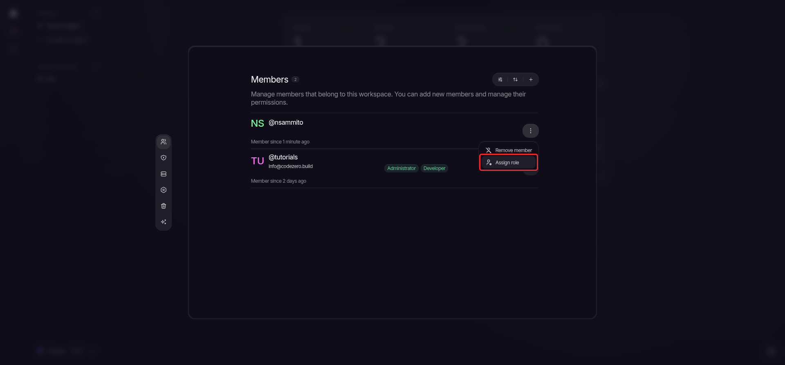
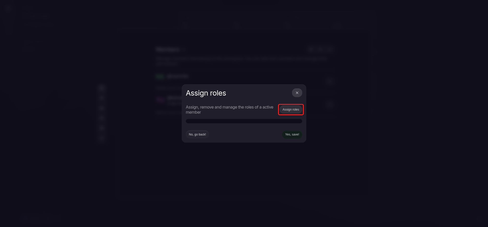
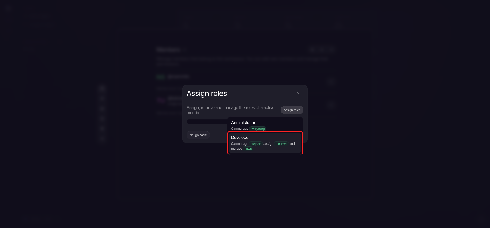
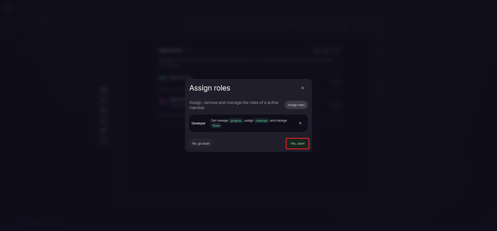
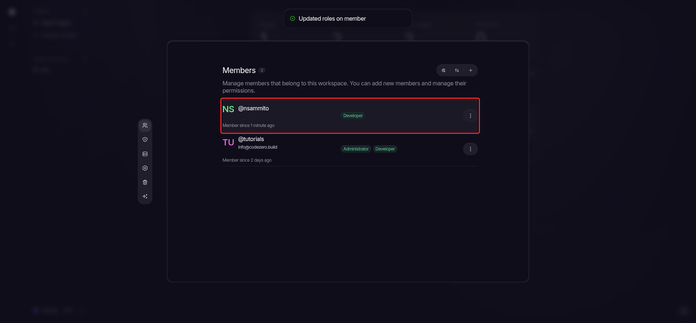

import { Callout } from 'fumadocs-ui/components/callout';
import { Step, Steps } from 'fumadocs-ui/components/steps';

Roles decide what a member of a workspace is allowed to do.
In this guide we'll give a member of a workspace a role.

<Callout type="info">
  **Prerequisite:** The user is already a member of the workspace, and the role exists. If not, follow the [Adding a member](./quick_adding_a_member.mdx) and [Creating a role](./quick_creating_a_role.mdx) tutorials first.
</Callout>

---

<Steps>
<Step>

## Open the workspace

On the home dashboard, click on the workspace the member belongs to.

</Step>
<Step>

## Open the workspace menu

At the bottom left of the sidebar, click on the workspace name to open the workspace menu.

</Step>
<Step>

## Open the members

Click **Members** in the workspace menu.

</Step>
<Step>

## Open the member's menu

The **Members** list shows every member of the workspace with the roles they already have.
Click the three dots on the right of the member you want to give a role.

</Step>
<Step>

## Click Assign role

Click **Assign role** in the menu.

</Step>
<Step>

## Add a role

The **Assign roles** dialog lists the roles the member currently has.
Click **Assign roles** to see the roles you can add.

</Step>
<Step>

## Select the role

Click on the role you want to assign, here **Developer**. Each role shows a short summary of what it allows.

</Step>
<Step>

## Save the roles

The role is added to the list. Click **Yes, save!** to apply the changes.
To take a role away instead, see [Removing a role from a member](./quick_removing_a_role.mdx).

</Step>
<Step>

## Check the result

An **Updated roles on member** message confirms the change, and the role appears next to the member in the **Members** list.

</Step>
</Steps>
