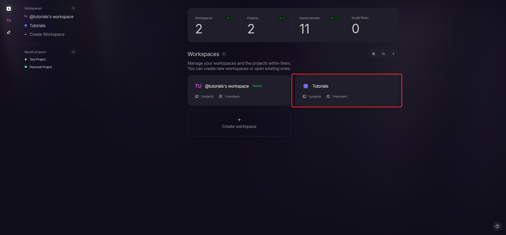
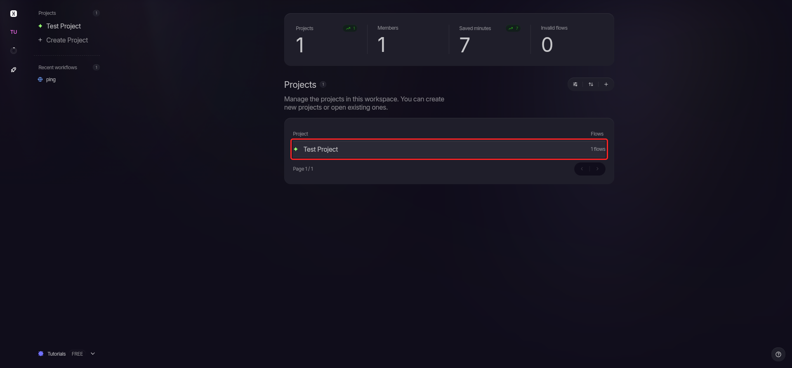
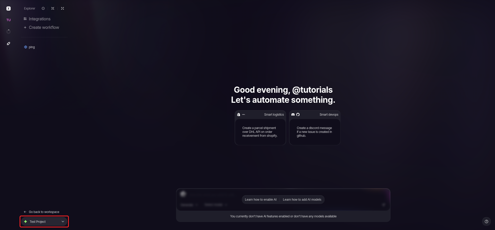
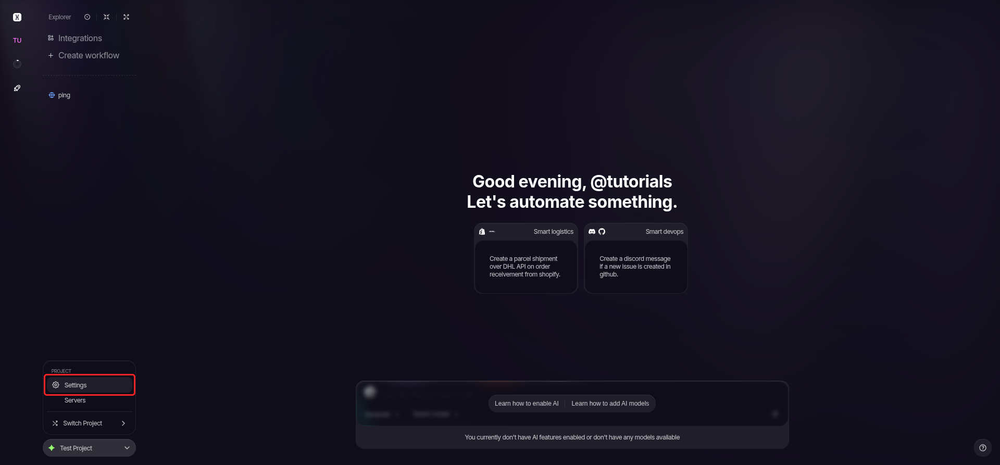
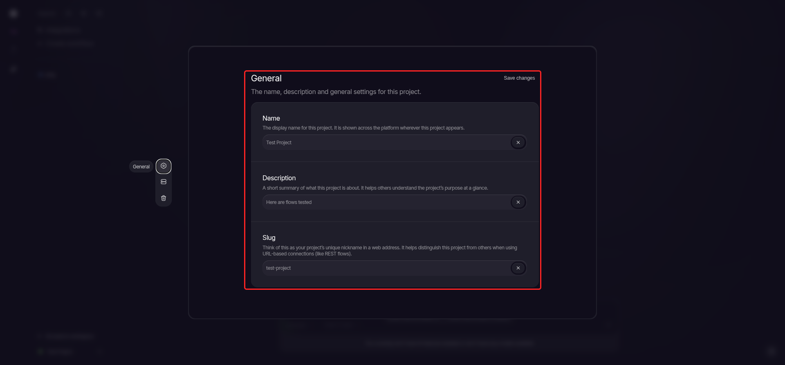
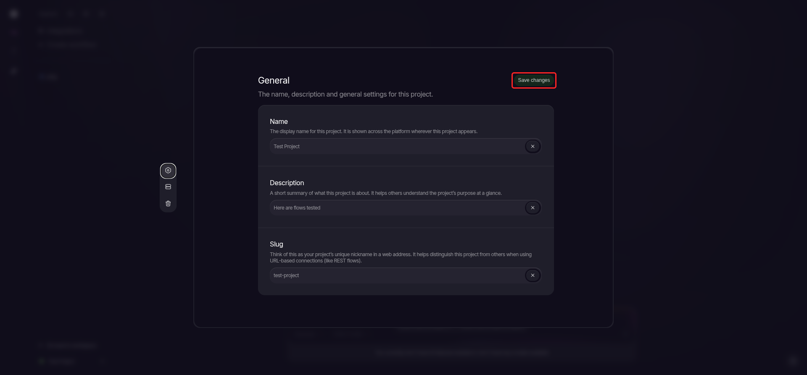

import { Callout } from 'fumadocs-ui/components/callout';
import { Step, Steps } from 'fumadocs-ui/components/steps';

Each project has a name, a description and a slug, which you can change at any time.
In this guide we'll open the project settings, edit them and save the changes.

---

<Steps>
<Step>

## Open the workspace

On the home dashboard, click on the workspace that contains your project.

</Step>
<Step>

## Open the project

In the **Projects** list, click on the project you want to change.

</Step>
<Step>

## Open the project menu

At the bottom left of the sidebar, click on the project name to open the project menu.

</Step>
<Step>

## Open the project settings

Click **Settings** in the project menu.

</Step>
<Step>

## Edit the general settings

The settings open on the **General** tab. Here you can change:

- **Name**: the display name shown across the platform wherever the project appears
- **Description**: a short summary that helps others understand the project's purpose at a glance
- **Slug**: the project's unique nickname in a web address, used for URL-based connections like REST flows

<Callout type="warn">
  The slug is part of the URLs of your REST flows. If you change it, those URLs change too, so update every place that calls them.
</Callout>

</Step>
<Step>

## Save your changes

Click **Save changes** in the top right to apply your changes.

</Step>
</Steps>
