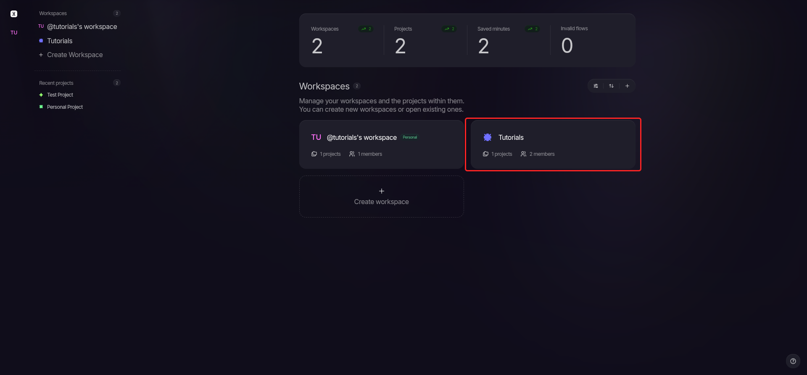
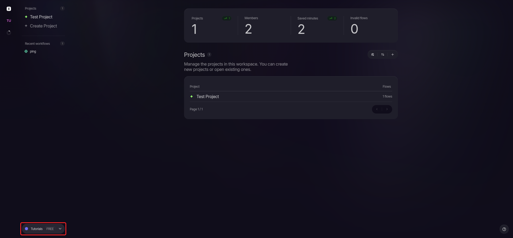
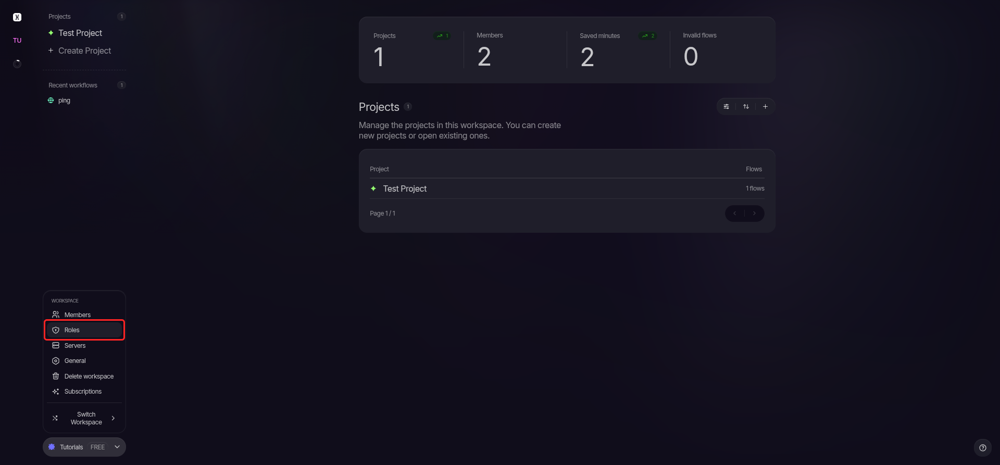
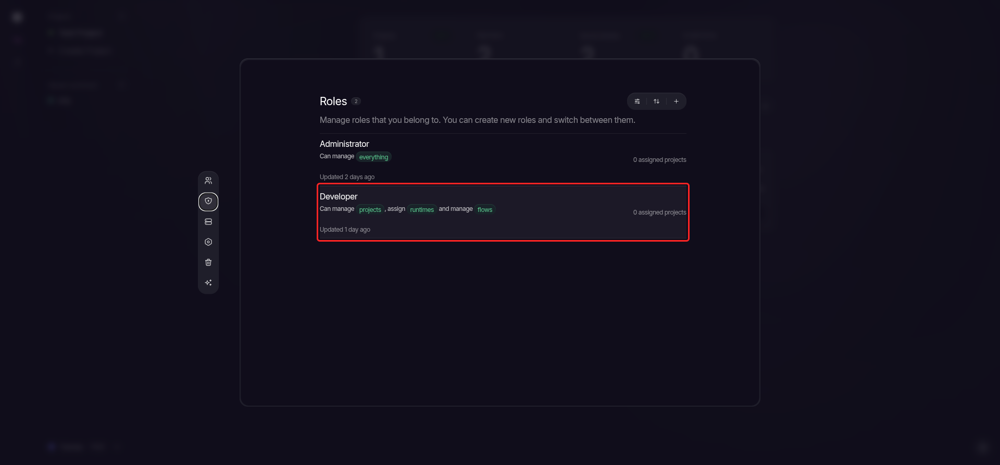
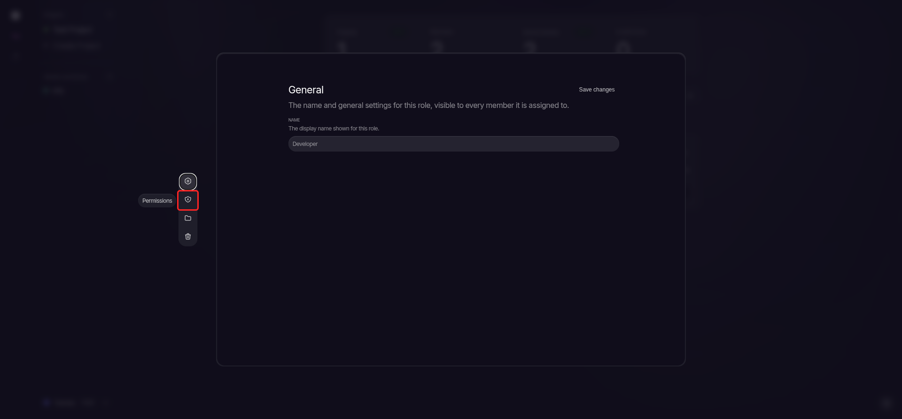
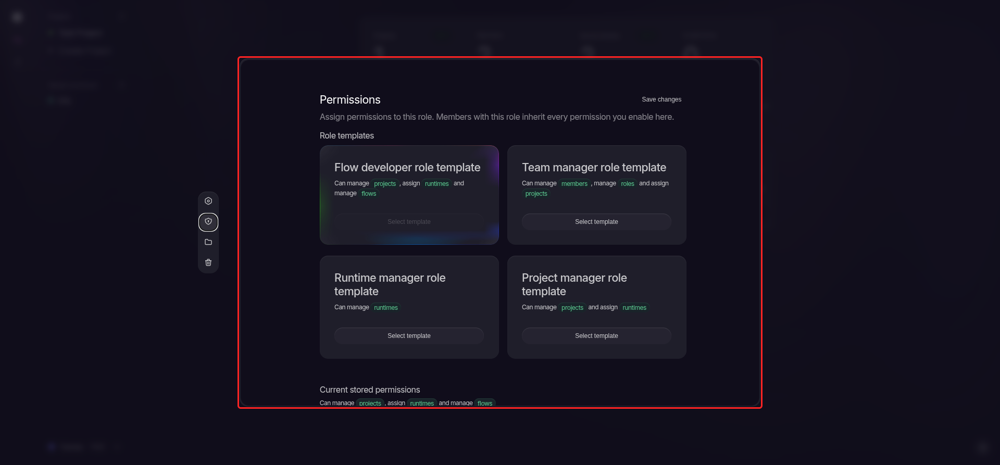
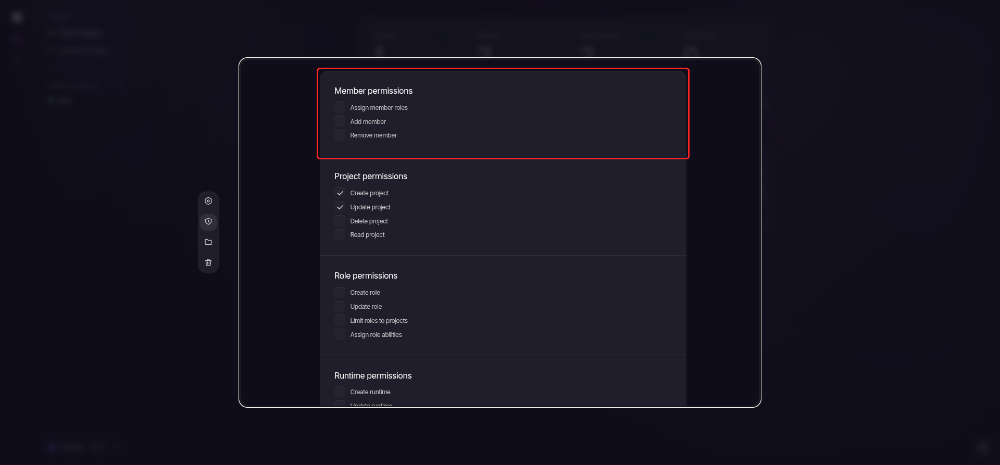
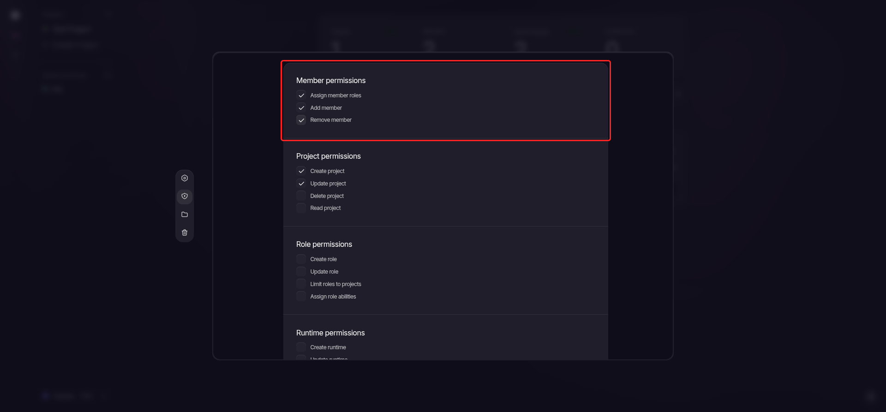
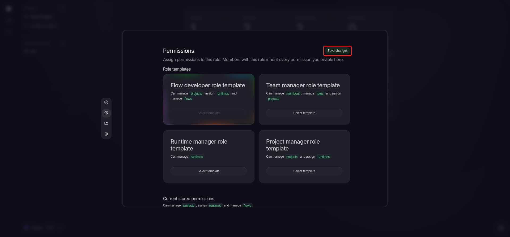
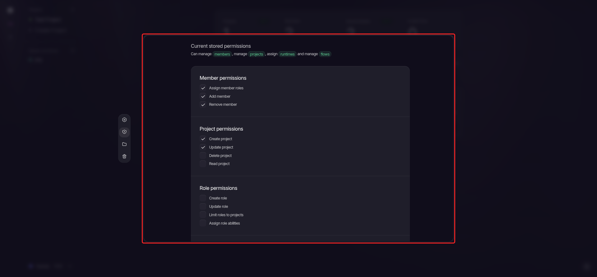

import { Callout } from 'fumadocs-ui/components/callout';
import { Step, Steps } from 'fumadocs-ui/components/steps';

The permissions of a role decide what its members are allowed to do.
In this guide we'll open an existing role, enable additional permissions and save them.

<Callout type="info">
  Changes apply to every member who has the role. If you only want to change what one member can do, give them a different role instead, see [Assigning a role](./quick_assigning_a_role.mdx).
</Callout>

---

<Steps>
<Step>

## Open the workspace

On the home dashboard, click on the workspace the role belongs to.

</Step>
<Step>

## Open the workspace menu

At the bottom left of the sidebar, click on the workspace name to open the workspace menu.

</Step>
<Step>

## Open the roles

Click **Roles** in the workspace menu.

</Step>
<Step>

## Open the role

The **Roles** list shows every role of the workspace with a summary of what it allows.
Click on the role you want to change, here **Developer**.

</Step>
<Step>

## Switch to the permissions tab

The role opens on the **General** tab. Click the shield icon in the tab bar on the left to switch to **Permissions**.

</Step>
<Step>

## Look at the permissions page

At the top you can apply one of the **Role templates** to replace the permissions with a predefined set.
Below that, **Current stored permissions** sums up what the role allows right now.

</Step>
<Step>

## Scroll to the permissions

Scroll down to the individual permissions. They are grouped by area, for example **Member permissions**, **Project permissions** and **Role permissions**.

</Step>
<Step>

## Select the permissions

Tick the permissions you want to enable and untick the ones you want to take away.
Here we enable all **Member permissions**: **Assign member roles**, **Add member** and **Remove member**.

</Step>
<Step>

## Save your changes

Scroll back up and click **Save changes** in the top right.

</Step>
<Step>

## Check the result

**Current stored permissions** now includes the new permissions, here **members**. Every member with this role has them from now on.

</Step>
</Steps>
