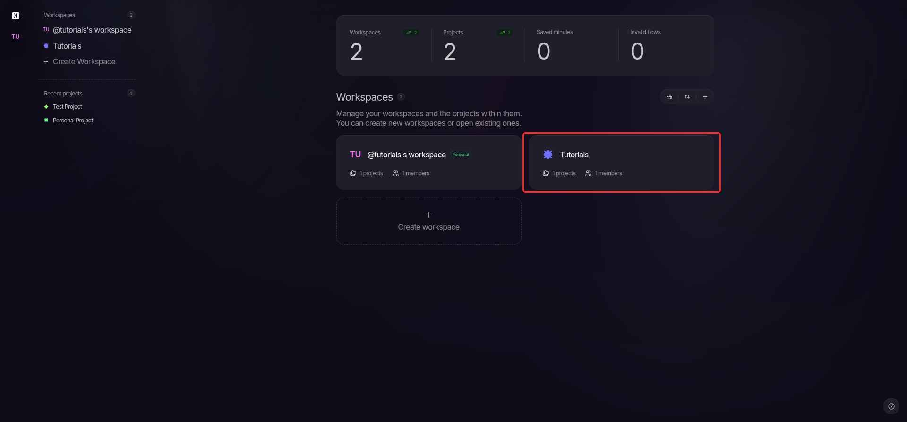
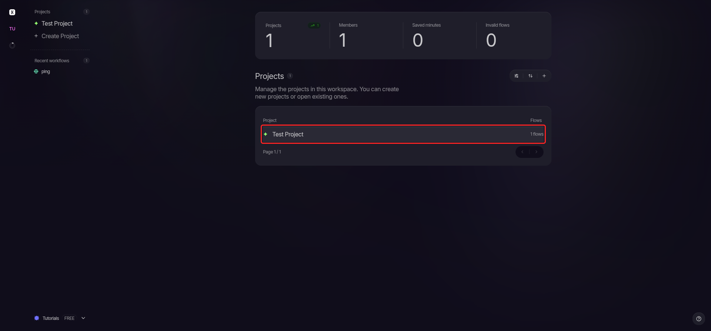
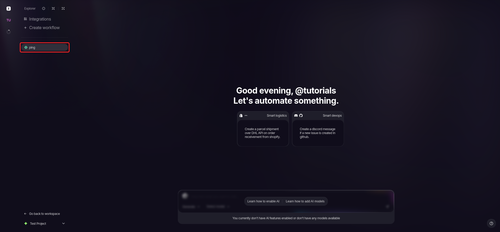
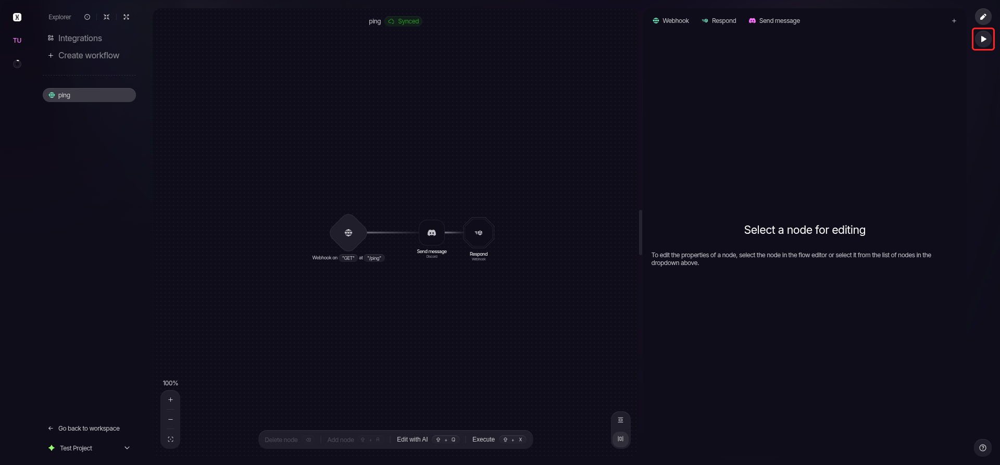
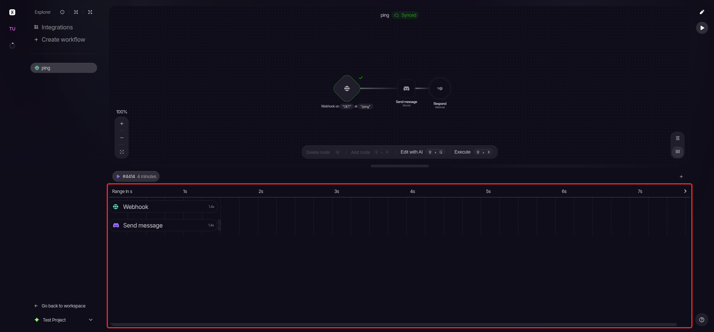
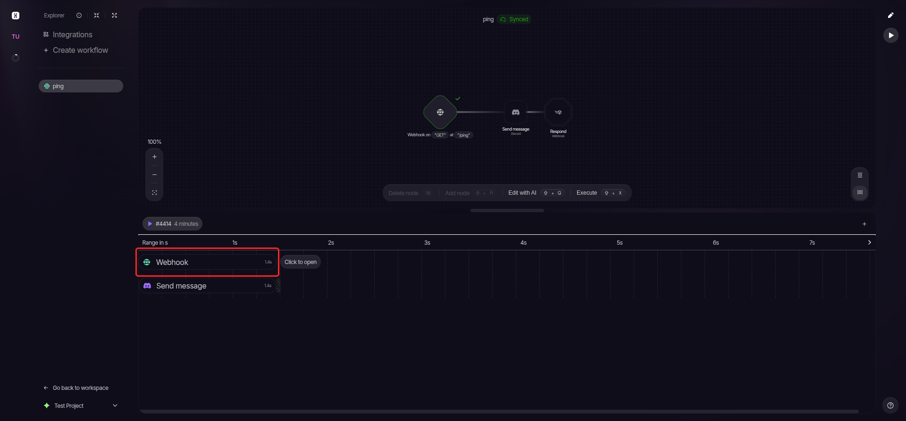
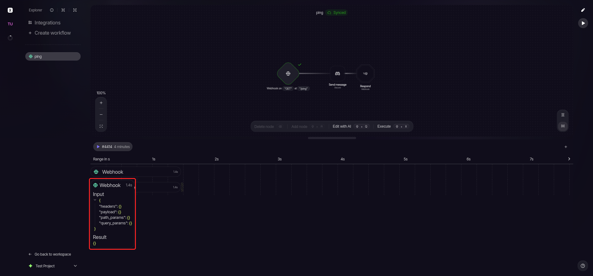
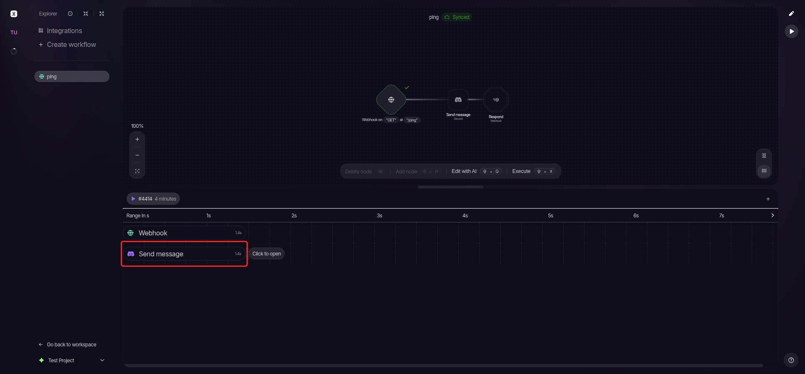
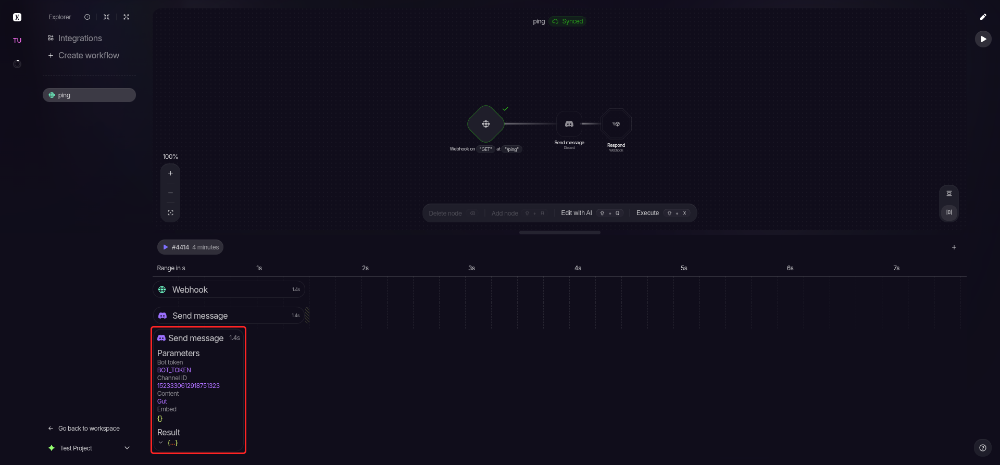
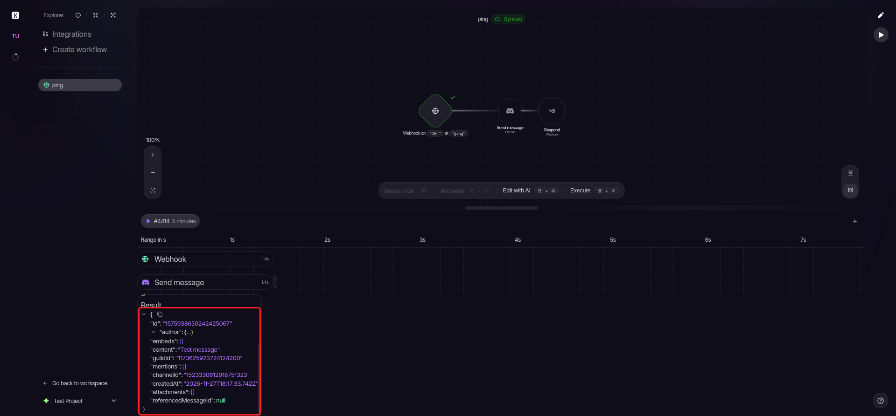

import { Step, Steps } from 'fumadocs-ui/components/steps';

Every time a flow runs, CodeZero records the execution: which nodes ran, how long each one took,
and what went in and came out of every node.
In this guide we'll open a flow, look at its last execution and inspect the input and result of each node.

---

<Steps>
<Step>

## Open the workspace

On the home dashboard, click on the workspace that contains your flow.

</Step>
<Step>

## Open the project

In the **Projects** list, click on the project that contains the flow.

</Step>
<Step>

## Open the flow

In the sidebar on the left, click on the flow whose executions you want to check.

</Step>
<Step>

## Open the execution panel

The flow opens in the editor. Click the play icon at the top right to open the execution panel.

</Step>
<Step>

## Read the timeline

The execution panel opens below the flow. At its top left you see which execution is shown and how long ago it ran, for example **#4414 4 minutes**.

The timeline lists every node that ran, in order, with the time it took. Nodes that ran successfully are marked with a check in the flow above.

</Step>
<Step>

## Open a node

Hover over a node in the timeline and click it to open its details.

</Step>
<Step>

## Check the input and result

The details show the **Input** the node received and the **Result** it produced.
For a Webhook trigger, the input contains the `headers`, `payload`, `path_params` and `query_params` of the incoming request.

</Step>
<Step>

## Open the next node

Click on the next node in the timeline, here **Send message**.

</Step>
<Step>

## Check the parameters

For action nodes, the details list the **Parameters** the node was called with, followed by its **Result**.
Click the arrow next to the result to expand it.

</Step>
<Step>

## Inspect the result

Scroll down in the details to see the full result. Here it is the message that was sent, as returned by Discord.
Use the copy icon next to the result to copy it to your clipboard.

</Step>
</Steps>

---

### What are my next steps?

Don't have a flow yet? Follow the [Creating your first flow](./quick_creating_a_flow.mdx) tutorial and come back once it has run.
