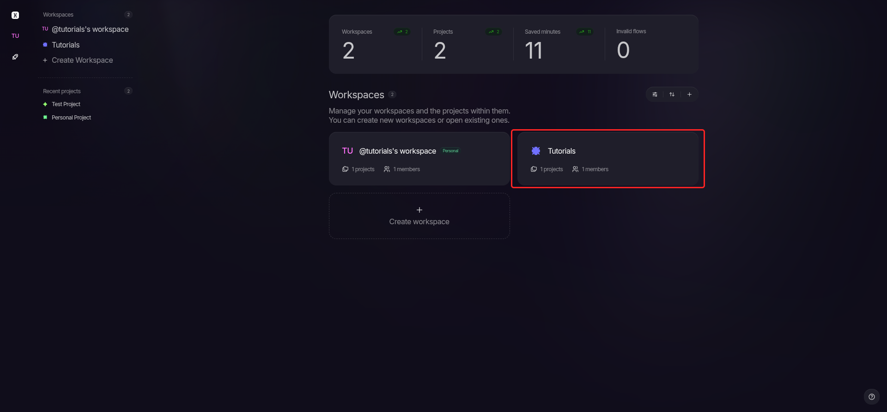
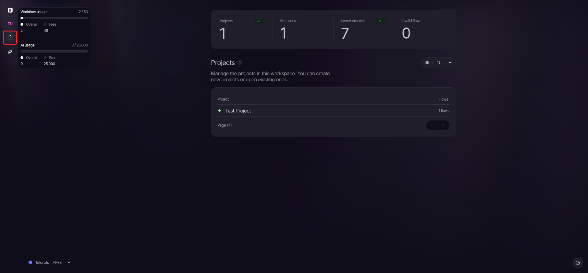
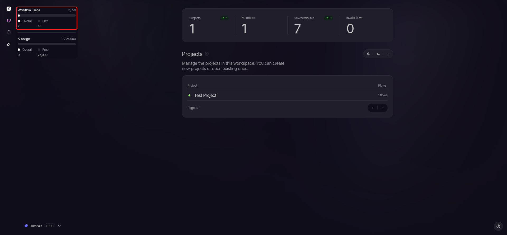
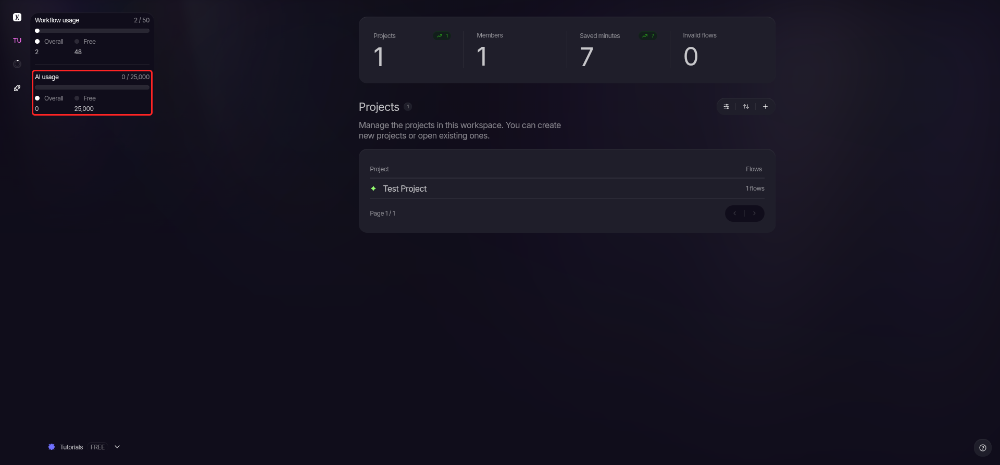

import { Callout } from 'fumadocs-ui/components/callout';
import { Step, Steps } from 'fumadocs-ui/components/steps';

Every workspace has a quota for workflow executions and AI tokens that depends on its plan.
In this guide we'll show you how to check how much of it you have already used.

---

<Steps>
<Step>

## Open the workspace

On the home dashboard, click on the workspace whose usage you want to check.

</Step>
<Step>

## Open the usage overview

In the icon bar on the far left, click the round usage indicator below your avatar. The usage overview opens next to it.

</Step>
<Step>

## Check your workflow usage

**Workflow usage** shows how many workflow executions this workspace has used in the current period, compared to its limit.
**Overall** is the number already used, **Free** is what you have left. In this example, 2 of 50 executions are used and 48 are left.

</Step>
<Step>

## Check your AI usage

**AI usage** works the same way for AI tokens. In this example, none of the 25,000 tokens are used yet.

</Step>
</Steps>

<Callout type="info">
  Need more? Open the workspace menu at the bottom left of the sidebar and choose **Subscriptions** to see your current plan and upgrade it.
</Callout>
