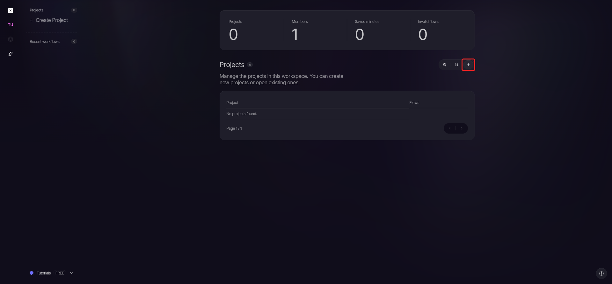
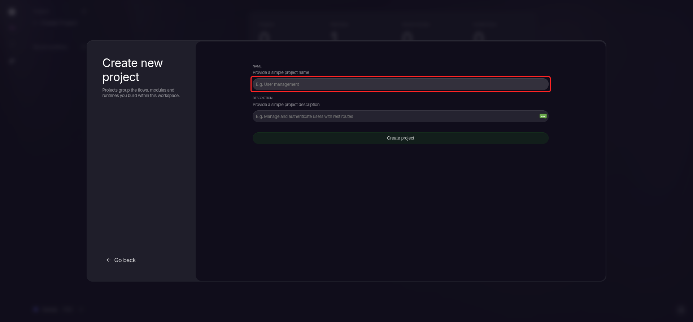
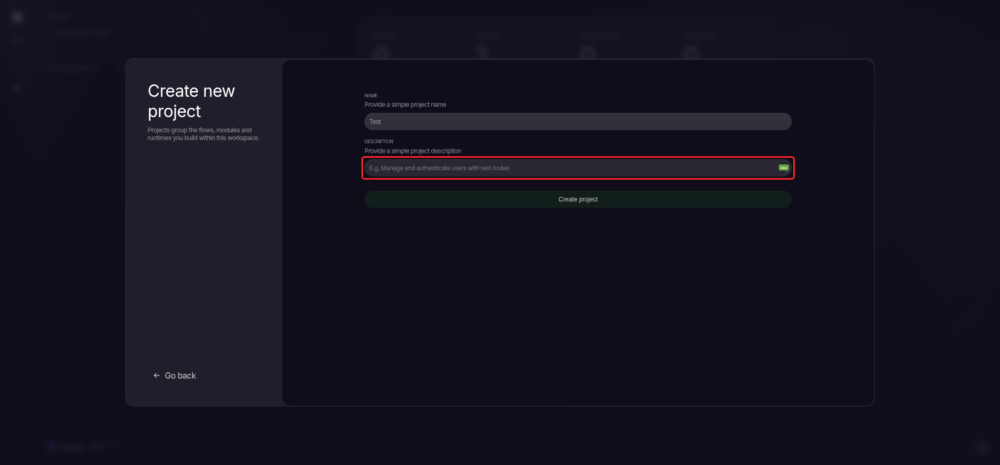
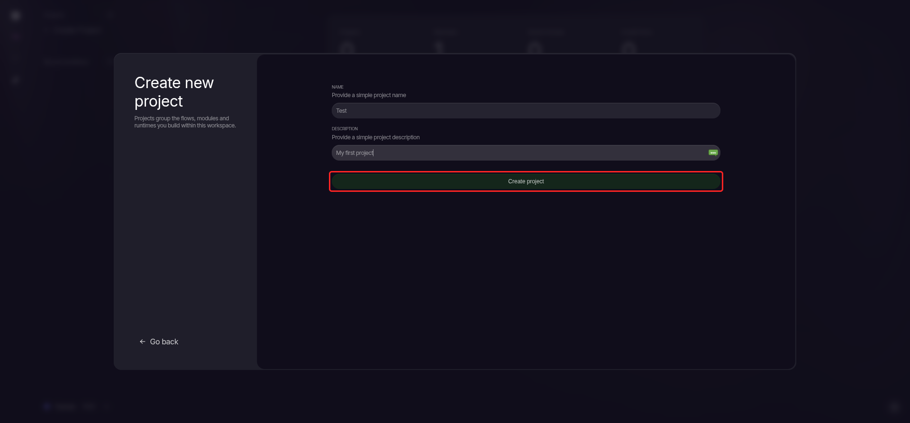
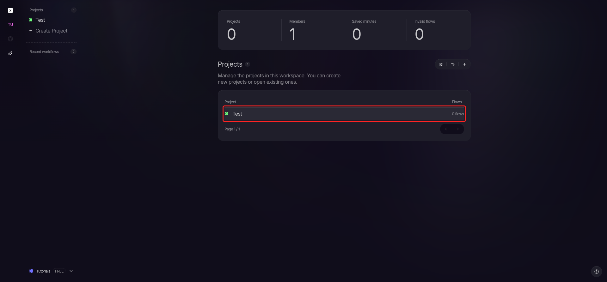
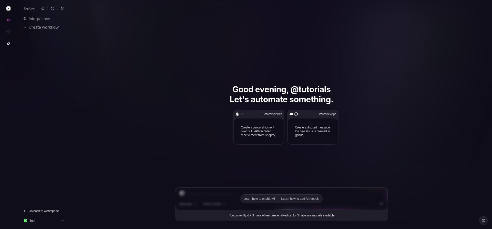

import { Callout } from 'fumadocs-ui/components/callout';
import { Step, Steps } from 'fumadocs-ui/components/steps';

Projects group the flows, modules and runtimes you build within a workspace.
In this guide we'll create a new project and open it.

<Callout type="info">
  **Prerequisite:** You have opened the workspace the project should belong to. If you don't have one yet, follow the [Creating a workspace](./quick_creating_a_workspace) tutorial first.
</Callout>

---

<Steps>
<Step>

## Start creating a project

In your workspace overview, click the **+** button next to the **Projects** heading.

<Callout type="info">
  You can also use **Create Project** in the sidebar on the left.
</Callout>

</Step>
<Step>

## Enter your project details

Give your project a short, descriptive **Name**, for example `User management`.

Then add a **Description** that explains what the project is for, for example `Manage and authenticate users with rest routes`.
This helps you and your team find the right project later.

Once both fields are filled out, click **Create project**.

</Step>
<Step>

## Open your new project

Your project now appears in the **Projects** list of the workspace and in the sidebar. Click on it to open it.

</Step>
<Step>

## Explore your project

You are now inside your project. On the left, the **Explorer** lists your flows and gives you access to **Integrations** and **Create workflow**.
Use **Go back to workspace** at the bottom left to return to the workspace overview at any time.

</Step>
</Steps>
