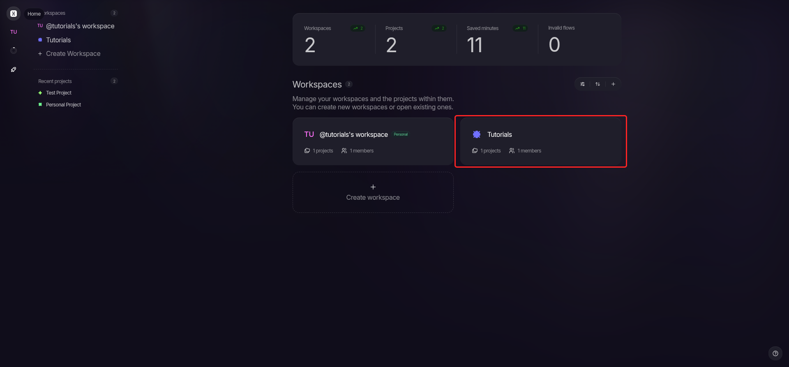
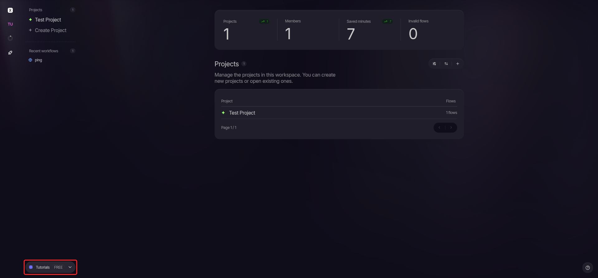
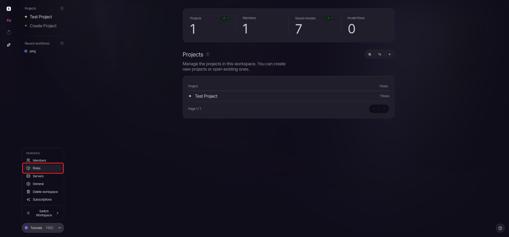
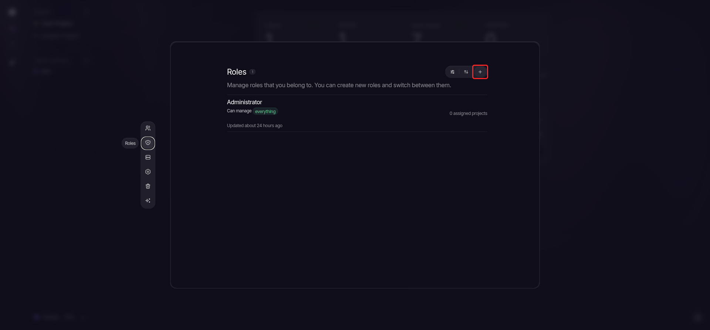
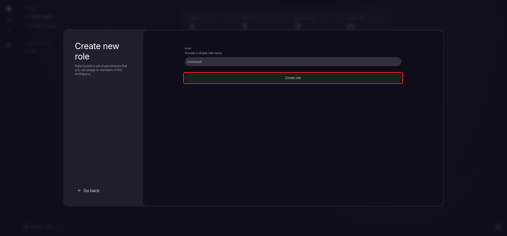
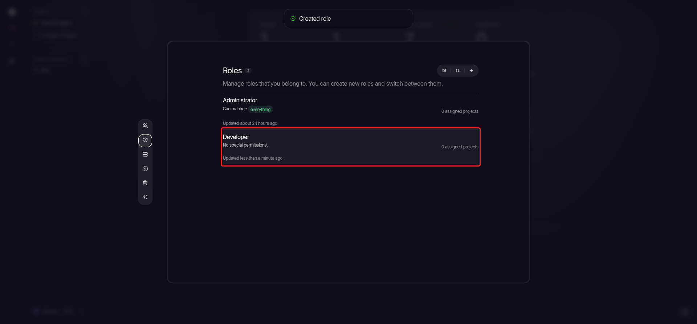
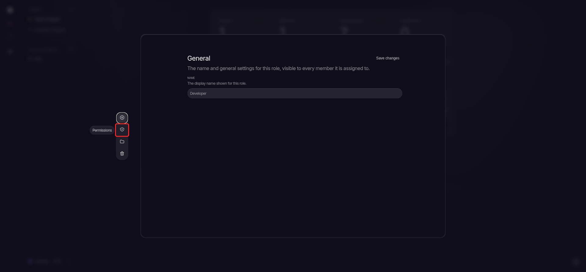
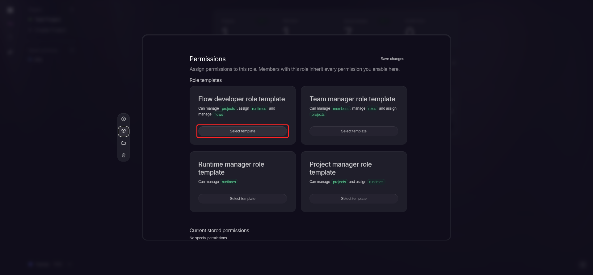
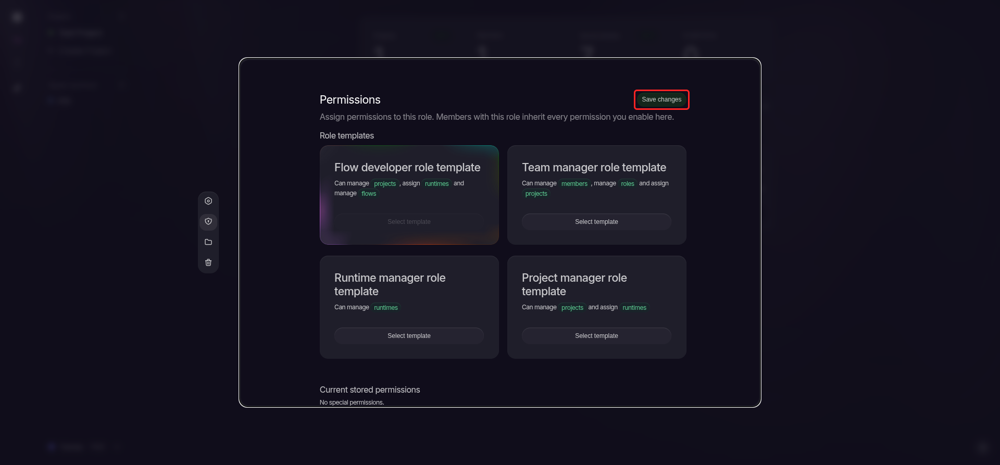

import { Callout } from 'fumadocs-ui/components/callout';
import { Step, Steps } from 'fumadocs-ui/components/steps';

Roles bundle a set of permissions that you can assign to members of a workspace.
In this guide we'll create a new role, give it permissions from a template and save it.

<Callout type="info">
  **Prerequisite:** You have a workspace and are allowed to manage its roles. If you don't have a workspace yet, follow the [Creating a workspace](./quick_creating_a_workspace.mdx) tutorial first.
</Callout>

---

<Steps>
<Step>

## Open the workspace

On the home dashboard, click on the workspace you want to create the role in.

</Step>
<Step>

## Open the workspace menu

At the bottom left of the sidebar, click on the workspace name to open the workspace menu.

</Step>
<Step>

## Open the roles

Click **Roles** in the workspace menu.

</Step>
<Step>

## Start creating a role

The **Roles** tab lists all roles of the workspace. Every workspace starts with an **Administrator** role that can manage everything.
Click the **+** button next to the **Roles** heading.

</Step>
<Step>

## Name your role

Enter a simple **Name** for the role, for example `Developer`, and click **Create role**.

</Step>
<Step>

## Open your new role

A **Created role** message confirms the new role, and it now appears in the list. A new role has no permissions yet.
Click on it to open its settings.

</Step>
<Step>

## Switch to the permissions tab

The role settings open on the **General** tab, where you can rename the role. Click the shield icon in the tab bar on the left to switch to **Permissions**.

</Step>
<Step>

## Select a role template

Role templates give a role a ready-made set of permissions:

- **Flow developer**: can manage projects, assign runtimes and manage flows
- **Team manager**: can manage members, manage roles and assign projects
- **Runtime manager**: can manage runtimes
- **Project manager**: can manage projects and assign runtimes

Click **Select template** on the template that fits your role, for example **Flow developer role template**.

<Callout type="info">
  If none of the templates fits, scroll down below the templates to choose the permissions for the role yourself.
</Callout>

</Step>
<Step>

## Save your changes

Click **Save changes** in the top right to store the permissions. Members with this role inherit every permission you enabled.

</Step>
</Steps>
