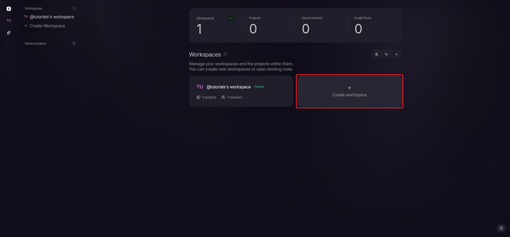
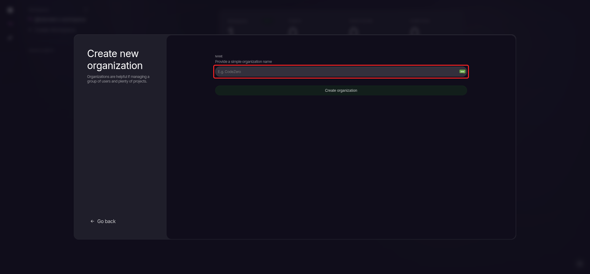
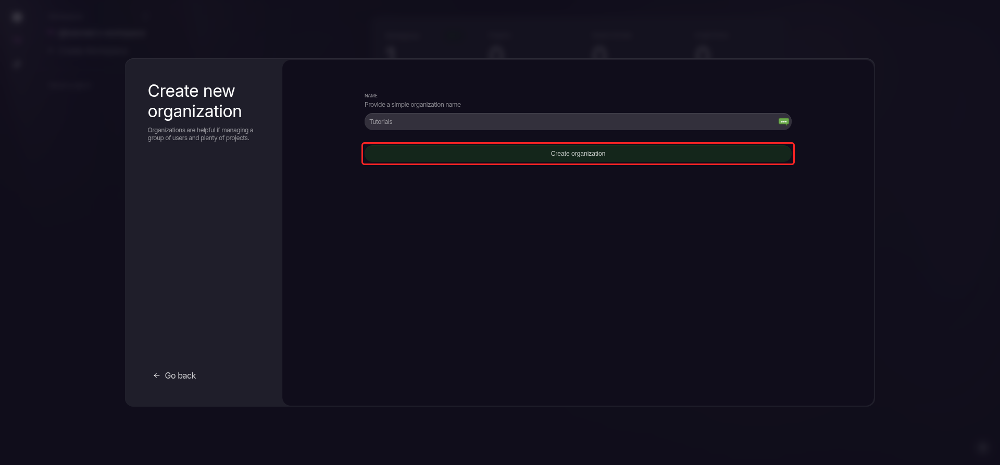
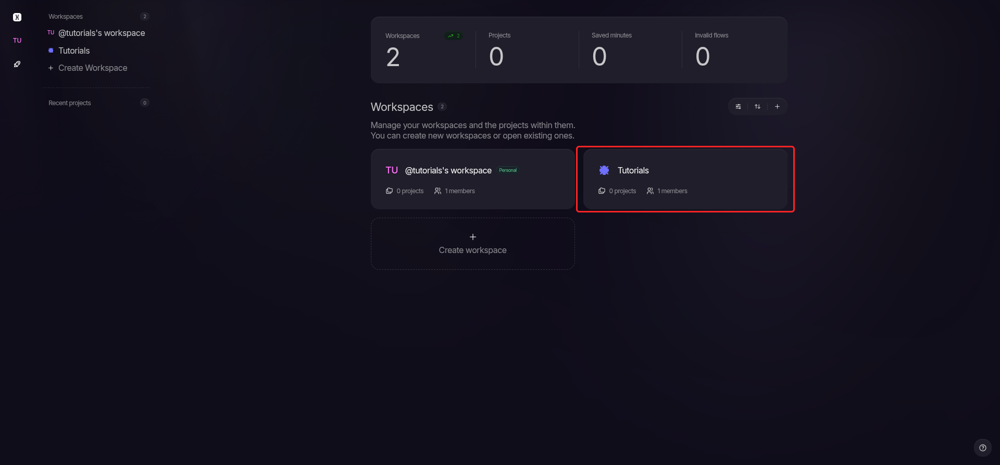
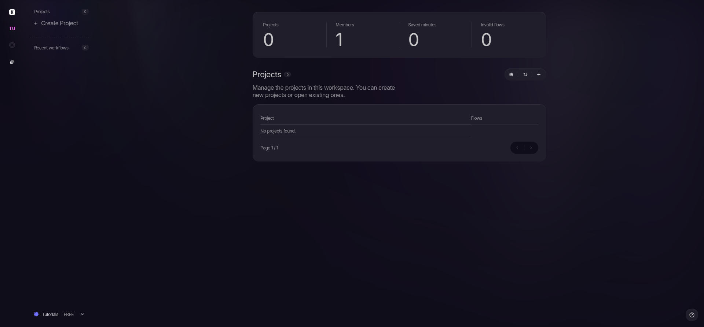

import { Callout } from 'fumadocs-ui/components/callout';
import { Step, Steps } from 'fumadocs-ui/components/steps';

Workspaces keep your projects organized. Next to your personal workspace, you can create additional workspaces,
for example for your team or company, and manage their projects and members in one place.

<Callout type="info">
  **Prerequisite:** You are logged in to the IDE. If not, follow the [How to login](./quick_how-to-login.mdx) tutorial first.
</Callout>

---

<Steps>
<Step>

## Start creating a workspace

On the home dashboard you can see all workspaces you are a member of. Click on the **Create workspace** card to start.

<Callout type="info">
  You can also use **Create Workspace** in the sidebar on the left.
</Callout>

</Step>
<Step>

## Name your organization

A new workspace is created as an **organization**. Enter a simple, recognizable name into the **Name** field, for example the name of your team or company.

Click **Create organization** to create the workspace.

</Step>
<Step>

## Open your new workspace

You're back on the dashboard and your new workspace appears next to your personal one. It also shows up in the sidebar. Click on it to open it.

</Step>
<Step>

## Explore the workspace

This is your workspace overview. At the top you can see the number of projects and members, and below the list of projects that belong to this workspace.
Since the workspace is brand new, there are no projects yet.

</Step>
</Steps>

---

### What are my next steps?

Your workspace is ready, but it's still empty.
Continue with the [Creating a project](./quick_creating_a_project.mdx) tutorial to add your first project to it.
