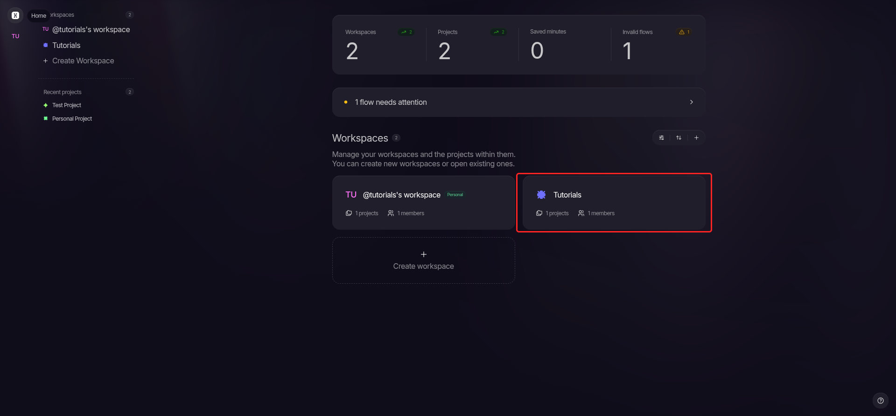
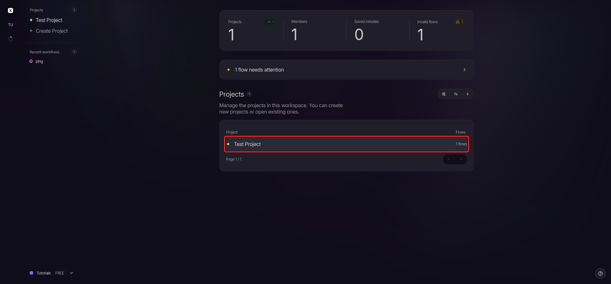
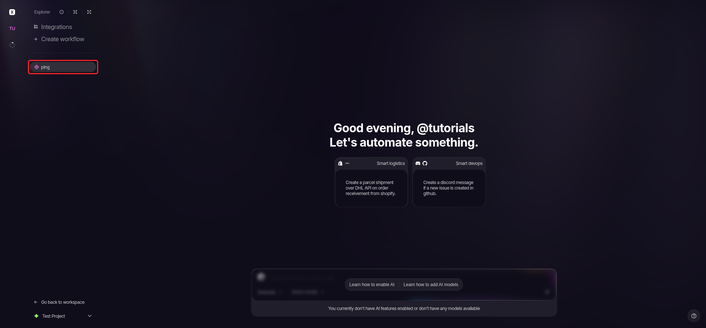
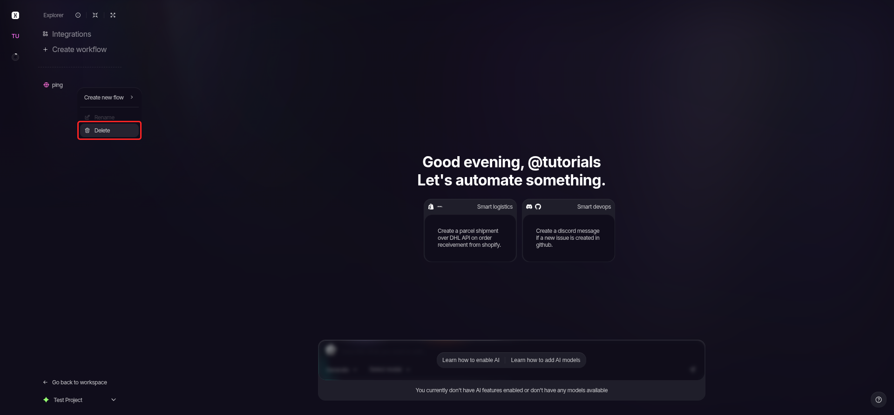
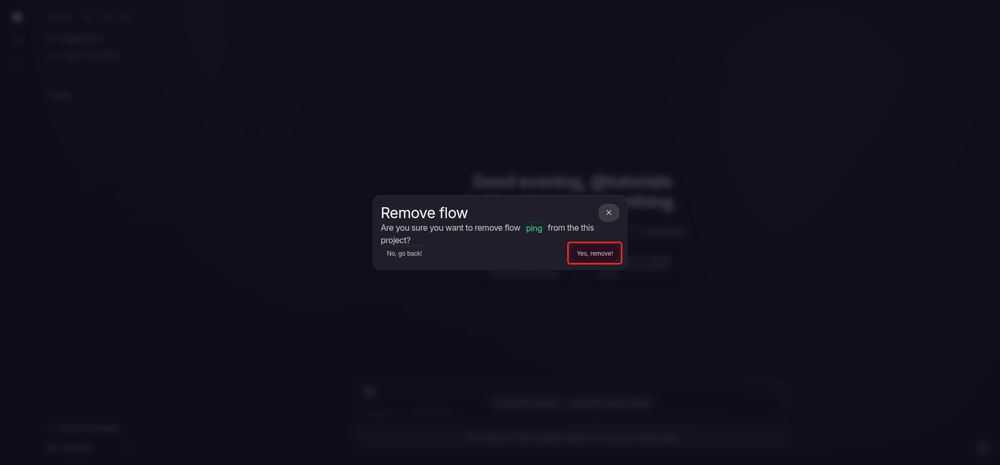
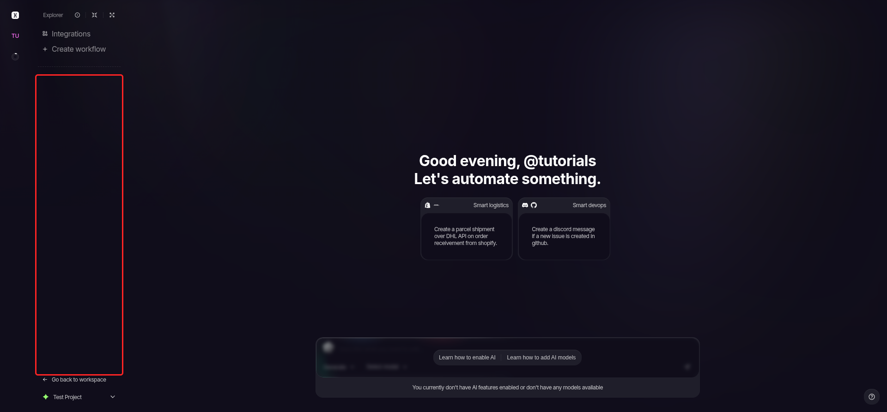

import { Callout } from 'fumadocs-ui/components/callout';
import { Step, Steps } from 'fumadocs-ui/components/steps';

If you no longer need a flow, you can remove it from its project.
In this guide we'll open a project and delete one of its flows from the sidebar.

<Callout type="warn">
  Deleting a flow permanently removes it from the project. This action cannot be undone.
</Callout>

---

<Steps>
<Step>

## Open the workspace

On the home dashboard, click on the workspace that contains the flow you want to delete.

</Step>
<Step>

## Open the project

In the **Projects** list, click on the project that contains the flow.

</Step>
<Step>

## Right-click the flow

The flows of the project are listed in the sidebar on the left. Right-click on the flow you want to delete to open its context menu.

</Step>
<Step>

## Click Delete

Click **Delete** in the context menu.

</Step>
<Step>

## Confirm the deletion

A **Remove flow** dialog asks you to confirm. Check that it shows the name of the right flow, then click **Yes, remove!**.
Click **No, go back!** if you want to keep the flow.

</Step>
<Step>

## Check the result

The flow no longer appears in the sidebar.

</Step>
</Steps>

---

### What are my next steps?

Want to build a new one? Follow the [Creating your first flow](./quick_creating_a_flow.mdx) tutorial.
