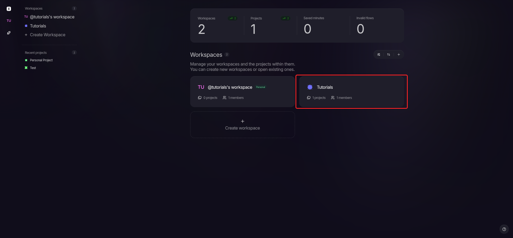
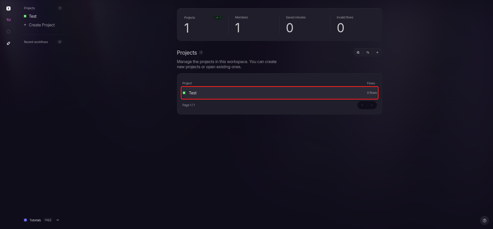
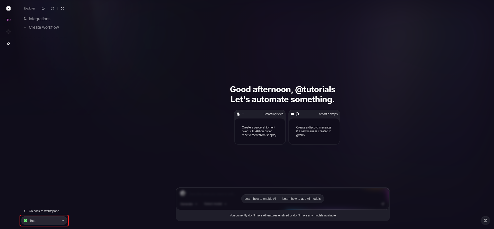
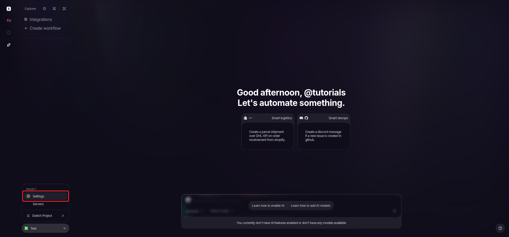
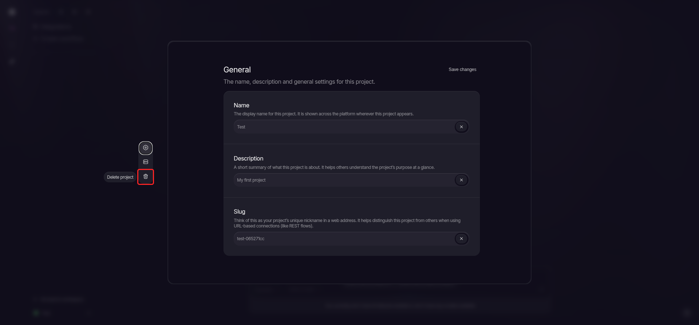
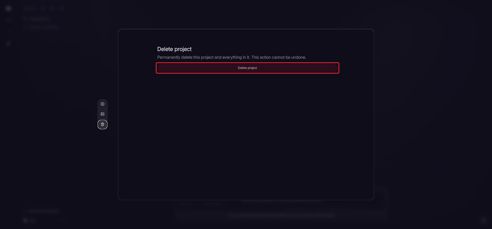
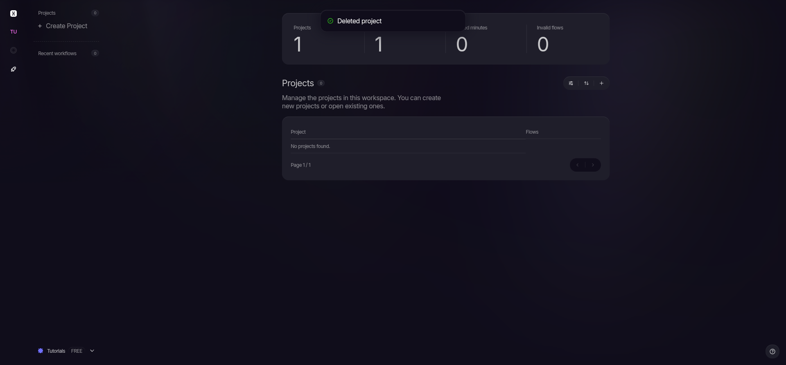

import { Callout } from 'fumadocs-ui/components/callout';
import { Step, Steps } from 'fumadocs-ui/components/steps';

If you no longer need a project, you can remove it from its workspace.
In this guide we'll open a project, go to its settings and delete it.

<Callout type="warn">
  Deleting a project permanently removes the project and everything in it, including all of its flows. This action cannot be undone.
</Callout>

---

<Steps>
<Step>

## Open the workspace

On the home dashboard, click on the workspace that contains the project you want to delete.

</Step>
<Step>

## Open the project

In the **Projects** list, click on the project you want to delete.

</Step>
<Step>

## Open the project menu

At the bottom left of the sidebar, click on the project name to open the project menu.

</Step>
<Step>

## Open the project settings

Click **Settings** in the project menu.

</Step>
<Step>

## Switch to the delete tab

The settings open on the **General** tab. Click the trash icon in the tab bar on the left to switch to **Delete project**.

</Step>
<Step>

## Delete the project

Make sure you have opened the right project, then click **Delete project**.

</Step>
<Step>

## Check the result

You are taken back to the workspace overview, where a **Deleted project** message confirms the deletion. The project no longer appears in the **Projects** list.

</Step>
</Steps>

---

### What are my next steps?

Need a fresh start? Follow the [Creating a project](./quick_creating_a_project) tutorial to add a new project to your workspace.
