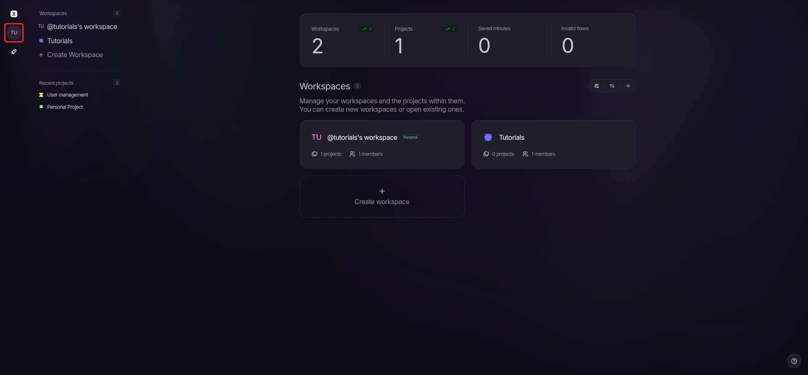
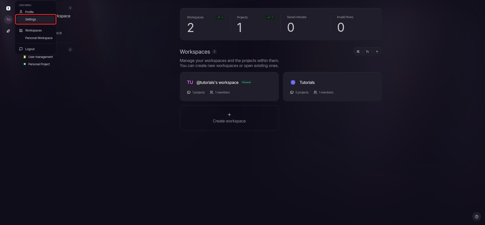
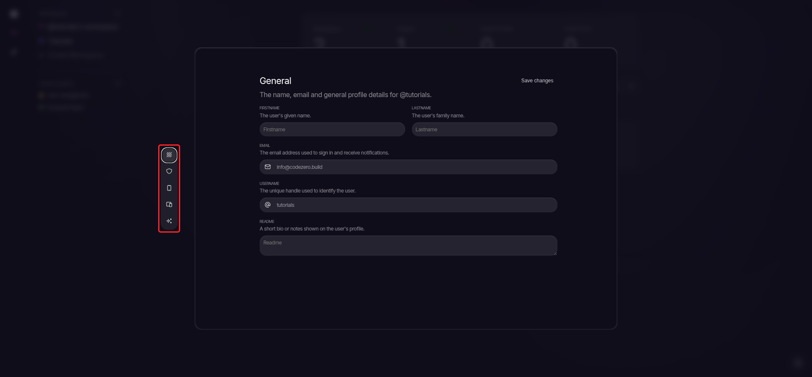

import { Callout } from 'fumadocs-ui/components/callout';
import { Step, Steps } from 'fumadocs-ui/components/steps';

Your account settings hold your profile details, your password, 2-step verification and your active sessions.
In this guide we'll show you where to find them.

---

<Steps>
<Step>

## Open the user menu

In the icon bar on the far left, click your avatar (your initials, for example **TU**) to open the user menu.

</Step>
<Step>

## Open the settings

Click **Settings** in the user menu.

</Step>
<Step>

## Navigate your settings

The settings open on the **General** tab, where you can change your first name, last name, email, username and readme.
Use the tab bar on the left to switch between the sections:

- **General**: your name, email, username and readme
- **Security**: change your password
- **2-Step Verification**: set up an authenticator app and backup codes
- **Sessions**: see your active sessions and log them out

<Callout type="info">
  Changes are only applied after you click **Save changes** in the top right.
</Callout>

</Step>
</Steps>
