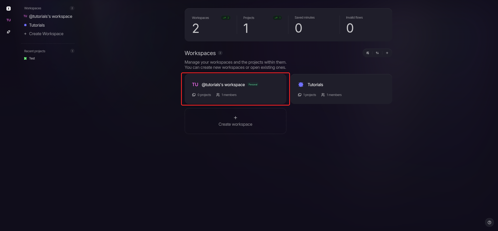
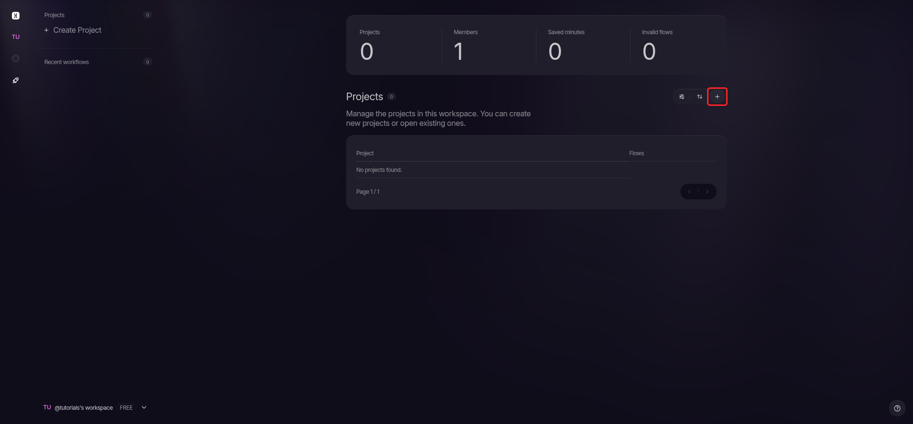
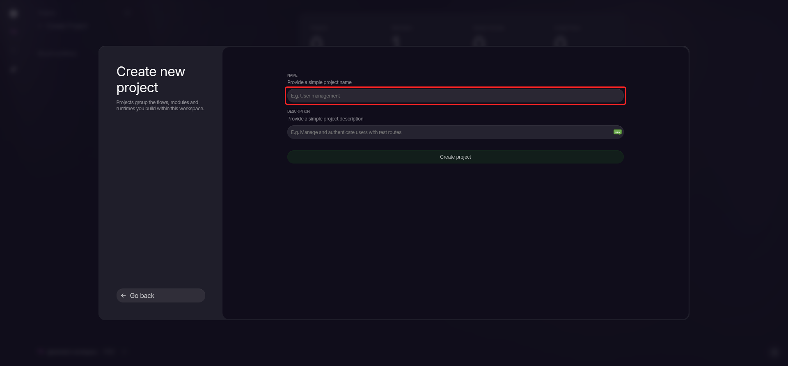
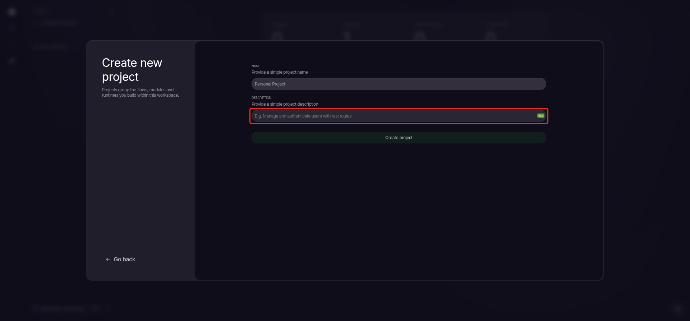
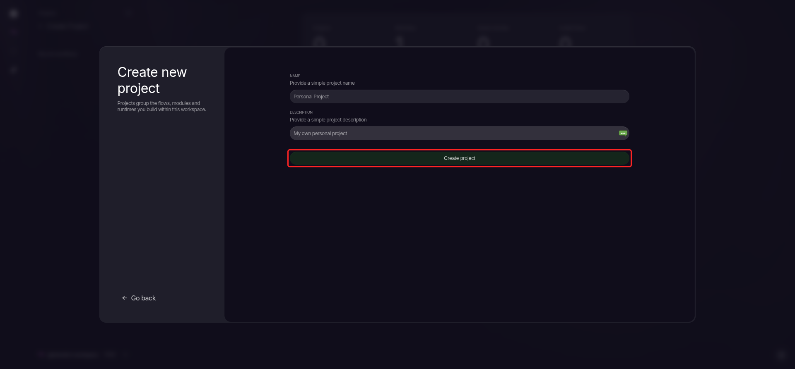
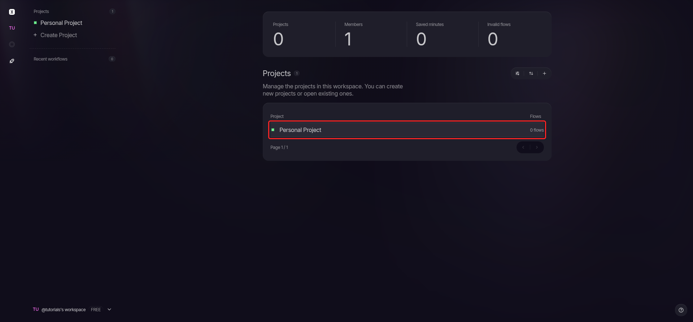
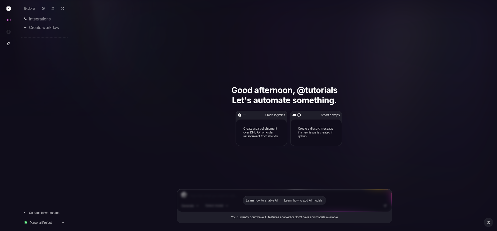

import { Callout } from 'fumadocs-ui/components/callout';
import { Step, Steps } from 'fumadocs-ui/components/steps';

Every account comes with a personal workspace. Projects you create there belong only to you,
which makes them a good sandbox to build, test and run your own flows.
In this guide we'll create a project in your personal workspace and open it.

---

<Steps>
<Step>

## Open your personal workspace

On the home dashboard, click on the workspace marked with the **Personal** badge. It is named after your username, for example `@tutorials's workspace`.

<Callout type="info">
  You can also open it at any time from the user menu: click your avatar in the top left and choose **Personal Workspace**.
</Callout>

</Step>
<Step>

## Start creating a project

In the workspace overview, click the **+** button next to the **Projects** heading.

<Callout type="info">
  You can also use **Create Project** in the sidebar on the left.
</Callout>

</Step>
<Step>

## Enter your project details

Give your project a short, descriptive **Name**, for example `Personal Project`.

Then add a **Description** that explains what the project is for, so you can find it again later.

Once both fields are filled out, click **Create project**.

</Step>
<Step>

## Open your new project

Your project now appears in the **Projects** list of your personal workspace. Click on it to open it.

</Step>
<Step>

## Explore your project

You are now inside your personal project. On the left, the **Explorer** lists your flows and gives you access to **Integrations** and **Create workflow**.
Use **Go back to workspace** at the bottom left to return to the workspace overview at any time.

</Step>
</Steps>
