import { Step, Steps } from 'fumadocs-ui/components/steps';

A flow becomes invalid when one of its nodes is missing a required setting or has a value of the wrong type.
In this guide we'll find an invalid flow from the home dashboard, see what is wrong with it and fix it.

---

<Steps>
<Step>

## Check the invalid flows counter

On the home dashboard, the **Invalid flows** counter at the top right shows how many of your flows have problems.
A warning sign next to it means at least one flow needs fixing.

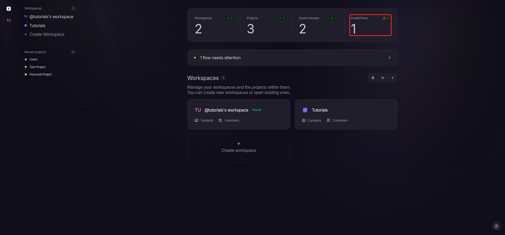

</Step>
<Step>

## Open the list of flows that need attention

Below the counters, click on **flow needs attention** to expand the list.

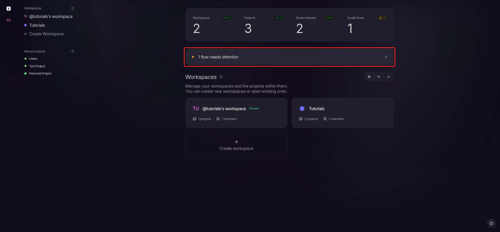

</Step>
<Step>

## Open the invalid flow

The list shows each invalid flow with its project and when it was last changed. Click on the flow you want to fix, here **ping**.

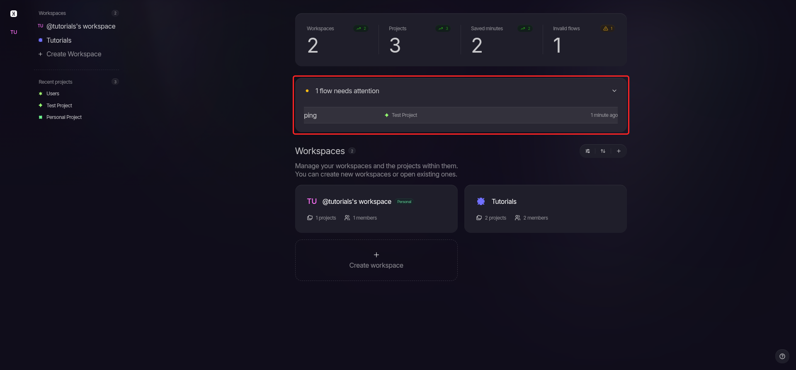

</Step>
<Step>

## Find the marked node

The flow opens in the editor. Look for the node with the problem: here the **Webhook** node shows `null` where the URL should be, underlined to mark the issue.

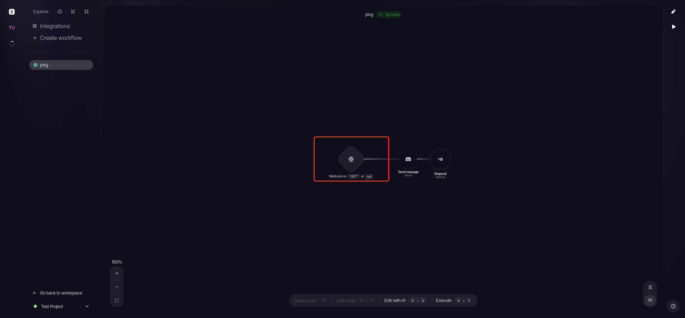

</Step>
<Step>

## Open the edit panel

Select the marked node, then click the pencil icon at the top right to open the edit panel.

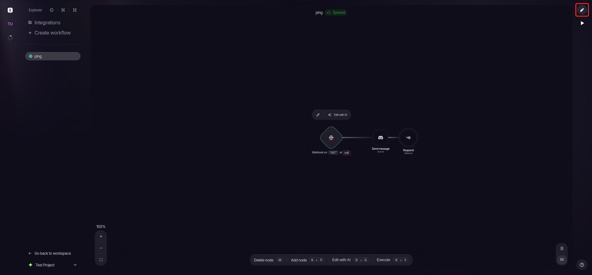

</Step>
<Step>

## Read the error

The setting with the problem is highlighted in red, with the error message below it.
Here the **URL** is empty: *Argument of type 'undefined' is not assignable to parameter of type 'string'* means the node expects text but got nothing.

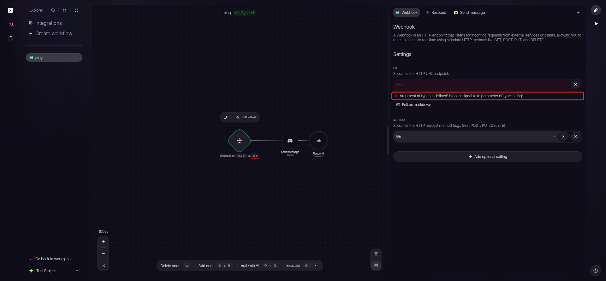

</Step>
<Step>

## Fix the setting

Click into the highlighted field and enter a valid value, here the URL `/ping`. The error disappears as soon as the value is valid.

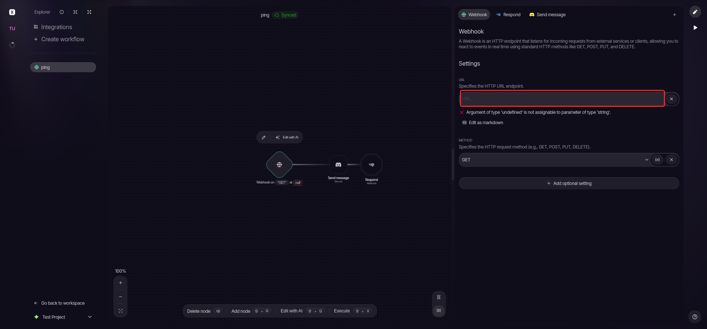

</Step>
<Step>

## Save the flow

Click **Unsaved. Save now** at the top of the editor. Changes are also saved automatically within one minute.

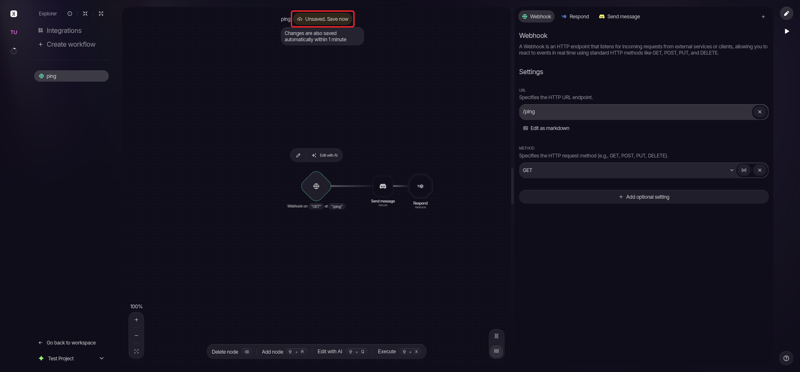

</Step>
<Step>

## Check that it is saved

A **Synced flow** message confirms that the flow is saved.

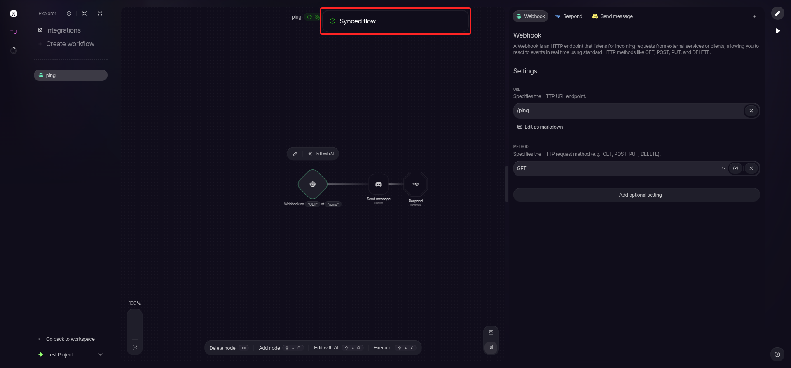

</Step>
<Step>

## Go back to the dashboard

Click the CodeZero logo at the top left to go back to the home dashboard.

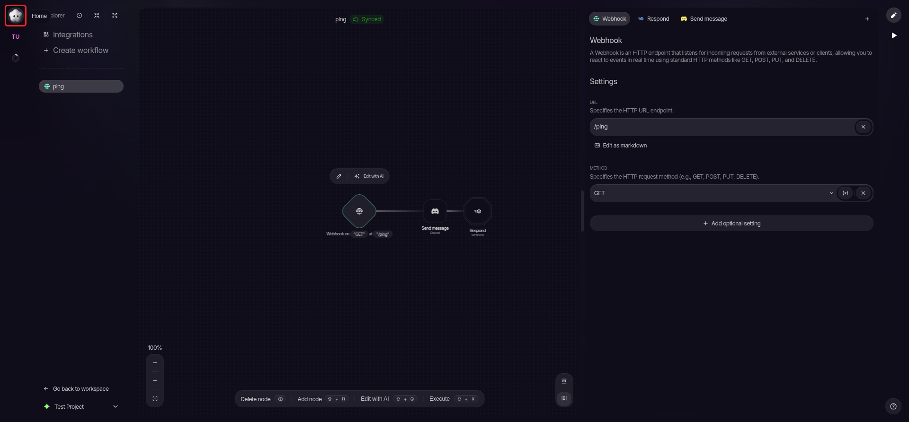

</Step>
<Step>

## Check the result

The **Invalid flows** counter is back to **0** and the list of flows that need attention is gone.

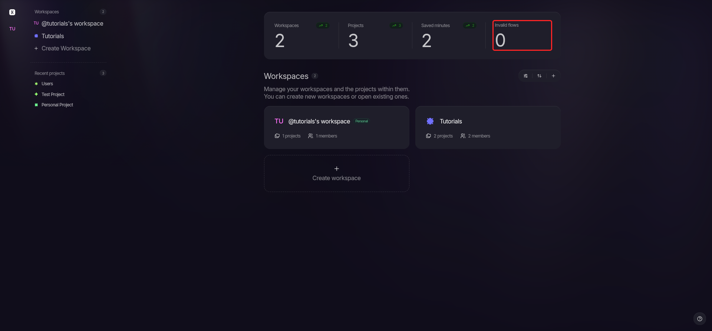

</Step>
</Steps>
