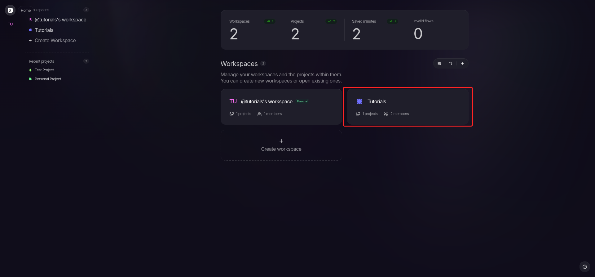
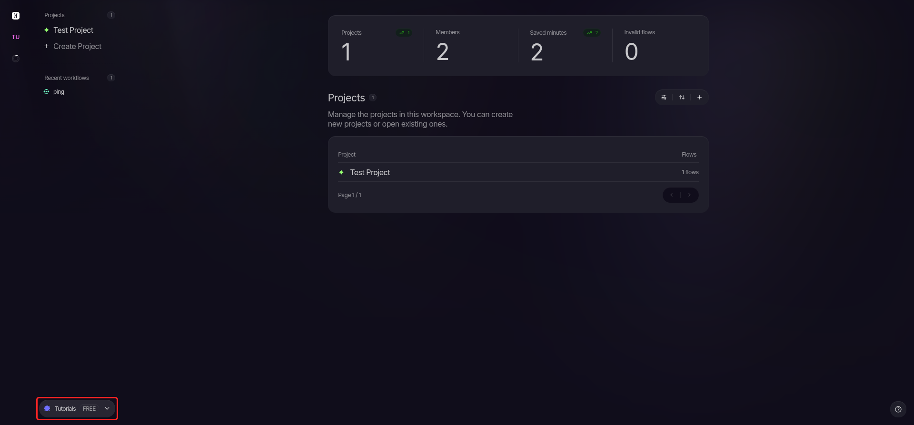
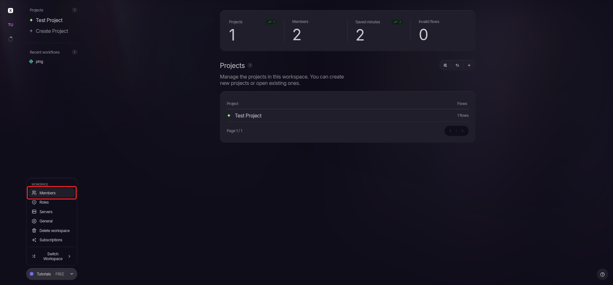
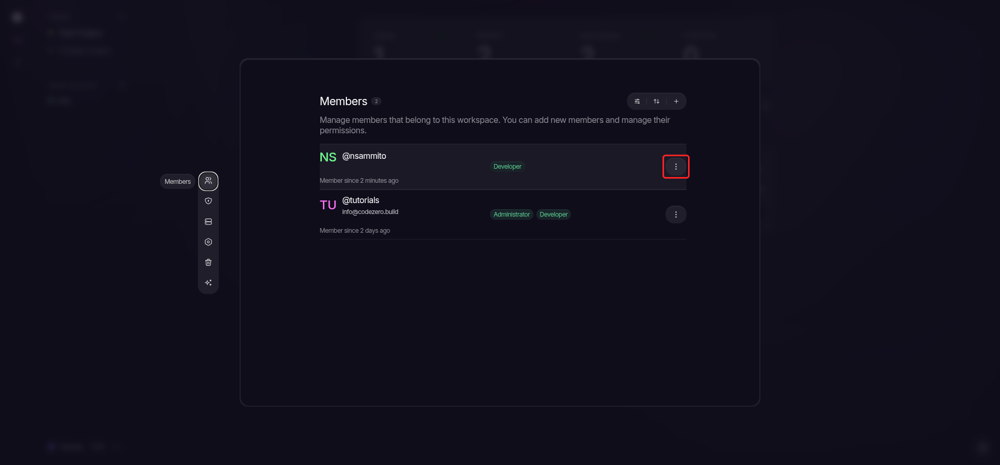
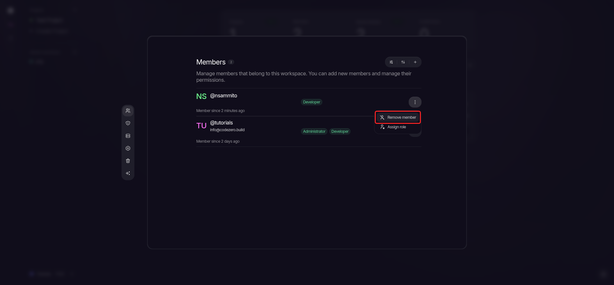
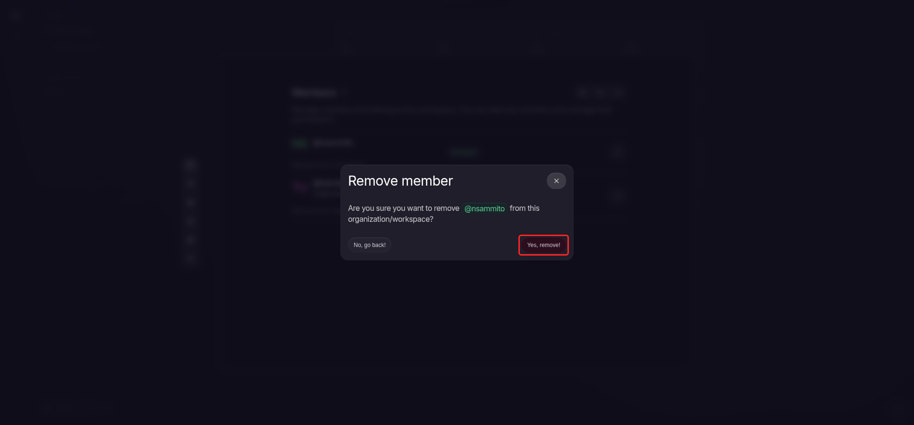
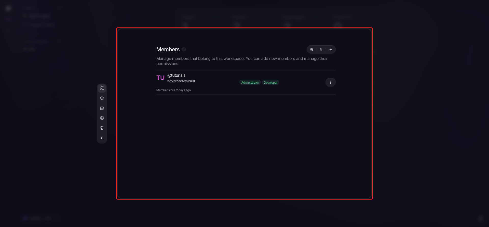

import { Callout } from 'fumadocs-ui/components/callout';
import { Step, Steps } from 'fumadocs-ui/components/steps';

When someone no longer works in a workspace, you can remove them as a member.
In this guide we'll remove a member from a workspace.

<Callout type="warn">
  The removed user loses access to the workspace, and their roles in it are gone. To give them access again, add them as a member again.
</Callout>

---

<Steps>
<Step>

## Open the workspace

On the home dashboard, click on the workspace you want to remove the member from.

</Step>
<Step>

## Open the workspace menu

At the bottom left of the sidebar, click on the workspace name to open the workspace menu.

</Step>
<Step>

## Open the members

Click **Members** in the workspace menu.

</Step>
<Step>

## Open the member's menu

Click the three dots on the right of the member you want to remove.

</Step>
<Step>

## Click Remove member

Click **Remove member** in the menu.

</Step>
<Step>

## Confirm the removal

A **Remove member** dialog asks you to confirm. Check that it shows the right user, then click **Yes, remove!**.
Click **No, go back!** if you want to keep the member.

</Step>
<Step>

## Check the result

The member no longer appears in the **Members** list.

</Step>
</Steps>
