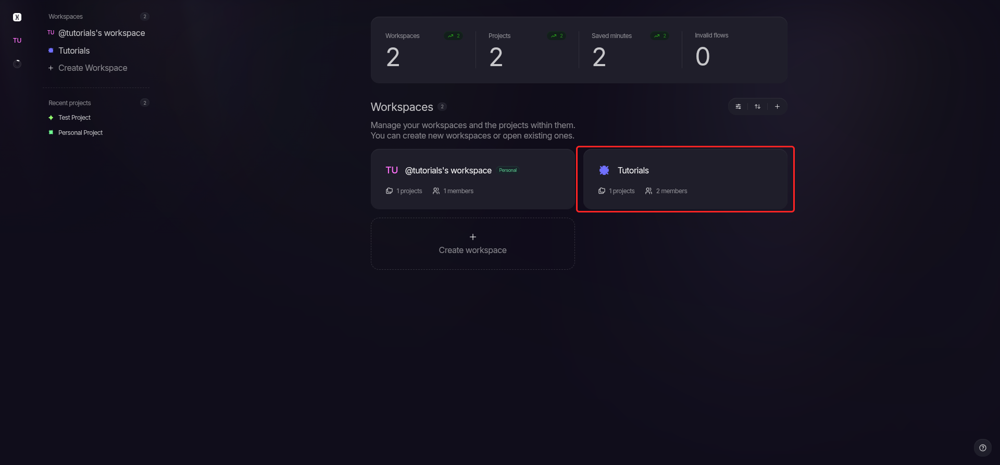
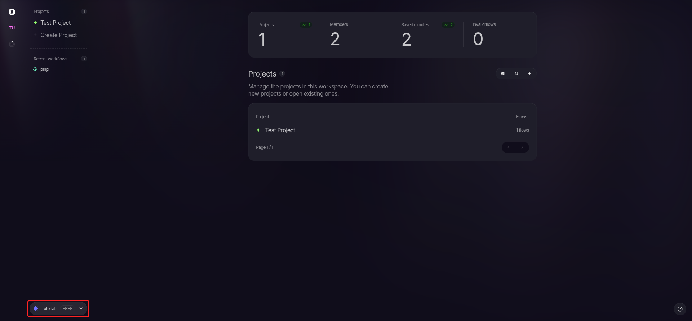
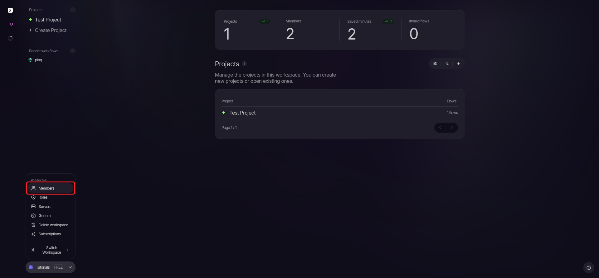
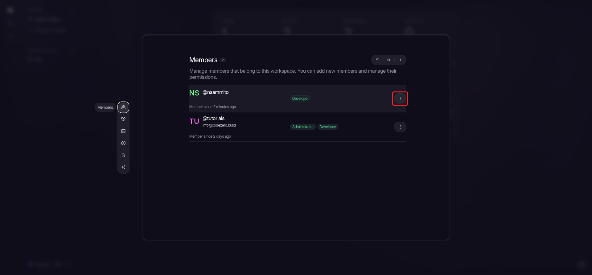
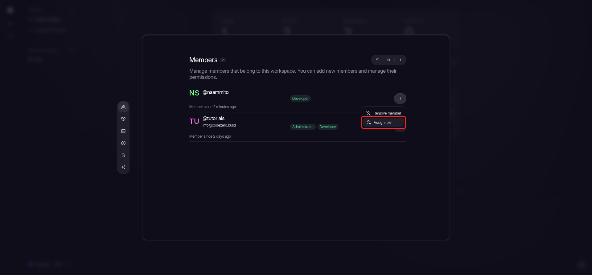
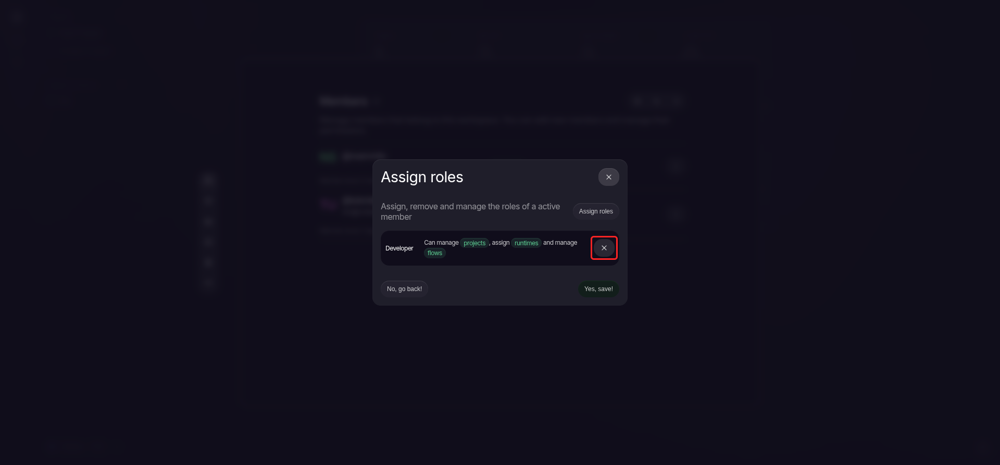
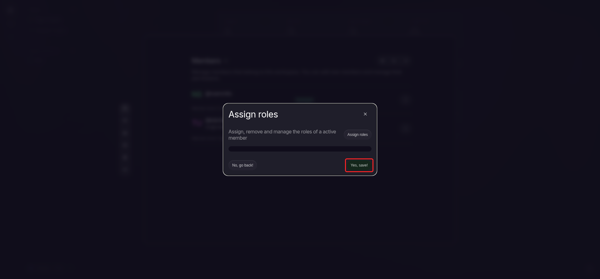
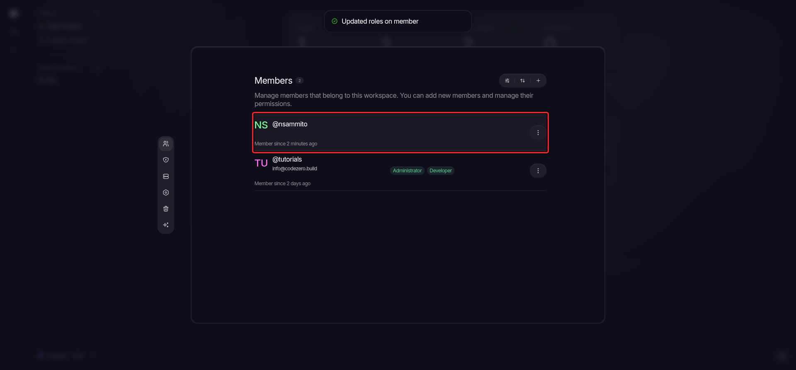

import { Callout } from 'fumadocs-ui/components/callout';
import { Step, Steps } from 'fumadocs-ui/components/steps';

When a member no longer needs the permissions of a role, you can take the role away.
In this guide we'll remove a role from a member of a workspace.

<Callout type="info">
  This only removes the role from this member. The role itself and its other members stay unchanged. To remove the member from the workspace altogether, follow the [Removing a member](./quick_removing_a_member.mdx) tutorial.
</Callout>

---

<Steps>
<Step>

## Open the workspace

On the home dashboard, click on the workspace the member belongs to.

</Step>
<Step>

## Open the workspace menu

At the bottom left of the sidebar, click on the workspace name to open the workspace menu.

</Step>
<Step>

## Open the members

Click **Members** in the workspace menu.

</Step>
<Step>

## Open the member's menu

Click the three dots on the right of the member whose role you want to remove.

</Step>
<Step>

## Click Assign role

Click **Assign role** in the menu. The same dialog is used to add and to remove roles.

</Step>
<Step>

## Remove the role

The **Assign roles** dialog lists the roles the member currently has.
Click the **×** next to the role you want to remove.

</Step>
<Step>

## Save the roles

The role disappears from the list. Click **Yes, save!** to apply the change.

</Step>
<Step>

## Check the result

An **Updated roles on member** message confirms the change, and the role no longer appears next to the member in the **Members** list.

</Step>
</Steps>
